# OODD.Charts

[简体中文](README.md) ｜ **English**

SkiaSharp renderer for the kind of form that has to line up cell by cell: temperature charts, partograms, code-blue records, work permits, VAT invoices, well logs, weather plots. These are not data visualisations. Generic chart controls cannot draw them, because cell sizes, line weights, several scales sharing one set of rules, and glyphs landing inside boxes are all hard constraints.

The approach here is to treat the layout as geometry. Each form gets a document model plus a template; the layout is solved once in 96 dpi logical units, and PNG / JPEG / PDF / SVG all come out of the same `SKPicture`. A 300 dpi export is just a `canvas.Scale`, so grid lines do not drift. The control layer is thin: WinForms, WPF and Avalonia can host a chart directly, and the radar supports click selection, hover and sweep animation out of the box.

Today: 40 forms, 14 NuGet packages, 7 host adapters. 473 tests run on both net8.0 and net462, and the 40 samples are rendered and checked against their layout geometry — "it renders" does not count as a pass.

| Temperature chart | Partogram |
|---|---|
| 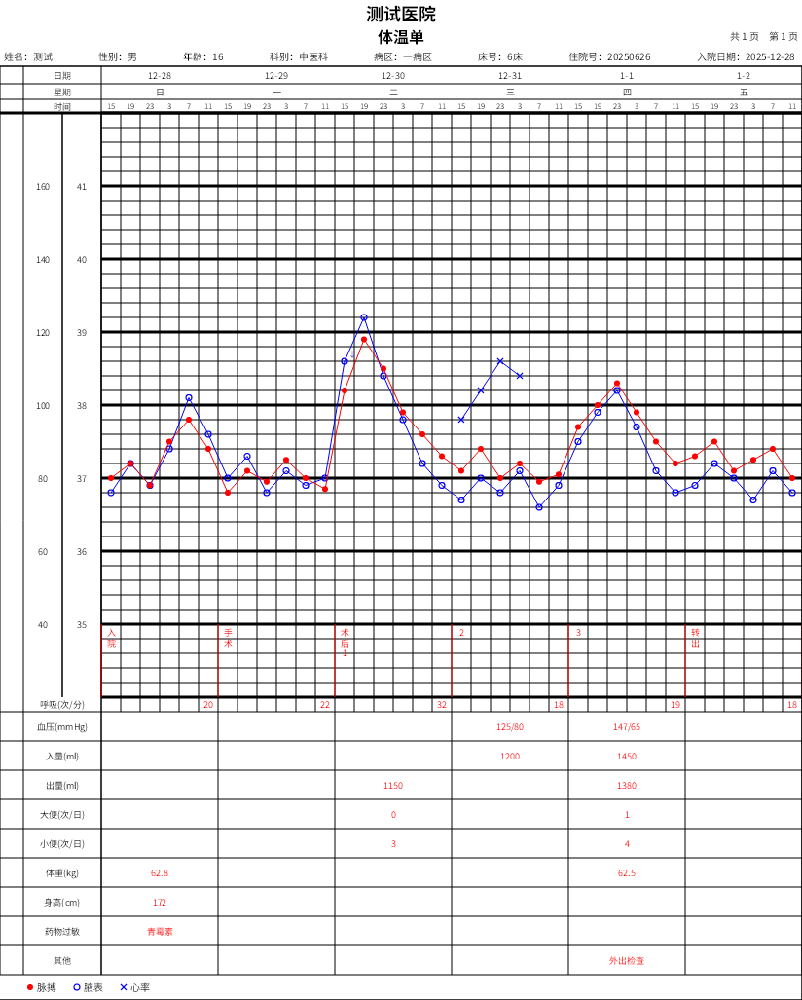 | 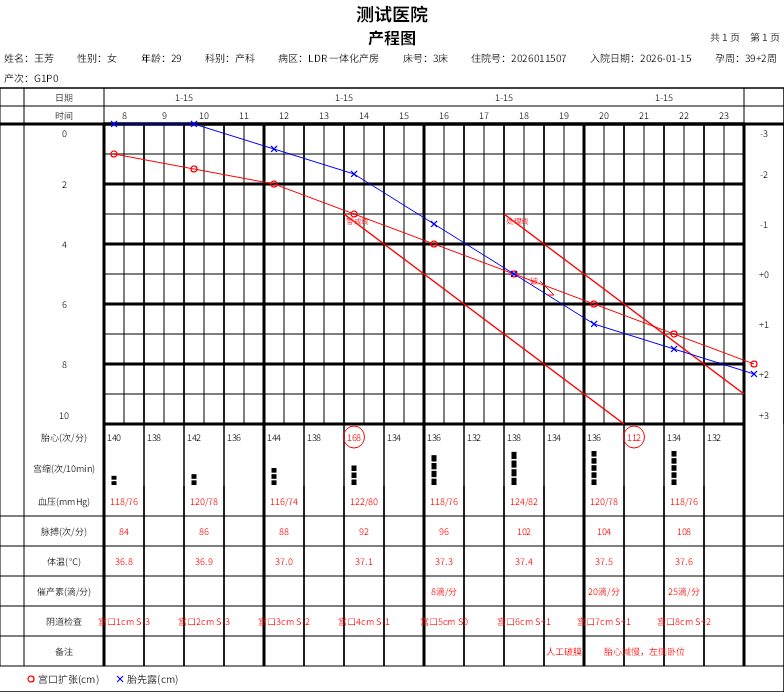 |

| Code Blue record | Radar PPI (360°) |
|---|---|
| 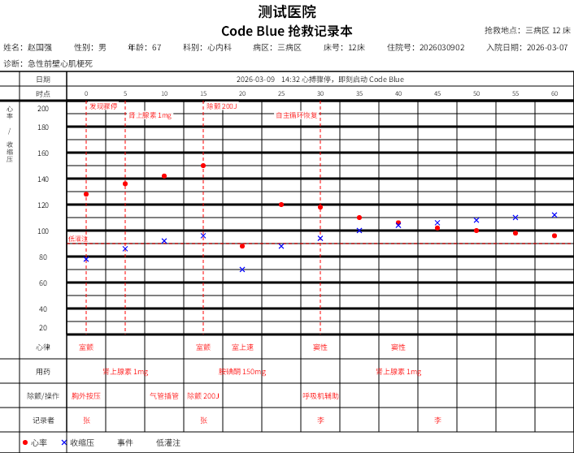 | 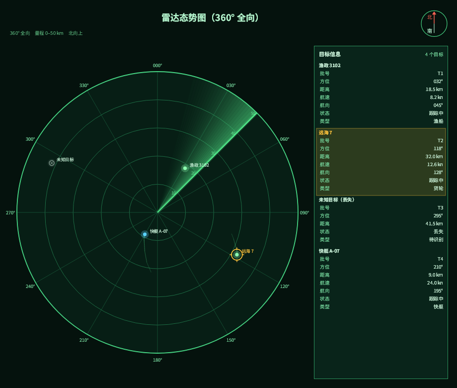 |

| Train graph | VAT invoice |
|---|---|
| 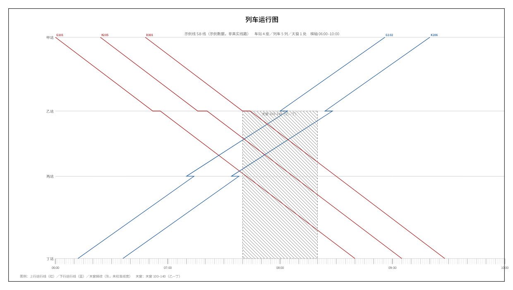 | 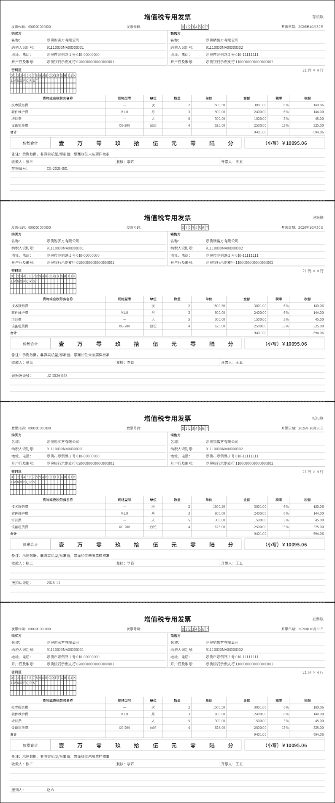 |

## Contents

- [Install](#install)
- [Quick start](#quick-start)
- [Medical forms](#medical-forms) (21)
- [Industry forms](#industry-forms) (17)
- [Radar, engines and host controls](#radar-engines-and-host-controls)
- [What is verified](#what-is-verified)
- [Known limitations](#known-limitations)
- [License](#license)

## Install

Packages ship with [Releases](https://github.com/OODD-DevNet/OODD.Charts/releases); they are not on nuget.org. Download the `.nupkg` files into a folder, add it as a local source, and install:

```bash
mkdir packages && cd packages
# put the downloaded nupkg files here, then:
dotnet nuget add source . -n oodd-local
dotnet add package OODD.Charts.Medical --version 1.0.0
```

| Package | What you get |
|---|---|
| `OODD.Charts.Core` | Render pipeline, geometry and axes, export, font fallback, interaction contracts |
| `OODD.Charts.Medical` | 5 hand-written templates + 16 data-driven records + 5 medical extensions (26 total) |
| `OODD.Charts.Radar` | Radar PPI and `RadarInteraction` |
| `OODD.Charts.Engineering` | Well log, transformer DGA |
| `OODD.Charts.Transit` | Train graph, load sheet, stowage plan, dangerous-goods consignment, oversize permit |
| `OODD.Charts.Geoscience` | Surface weather plot, T-lnP |
| `OODD.Charts.Tickets` | Electrical work permit, hot-work permit, VAT invoice |
| `OODD.Charts.Adapters.WinForms` | WinForms `ChartControl` + `ToBitmap` |
| `OODD.Charts.Adapters.Wpf` | WPF `ChartControl` + `ToWriteableBitmap` |
| `OODD.Charts.Adapters.Avalonia` | Avalonia `ChartControl` + `ToWriteableBitmap` |
| `OODD.Charts.Adapters.Eto` | Eto.Forms `ChartControl` + `ToEtoBitmap` |
| `OODD.Charts.Adapters.WinUi` | WinUI 3 `ChartControl` + `ToWriteableBitmap` |
| `OODD.Charts.Adapters.Uno` | Uno Platform `ChartControl` + `ToWriteableBitmap` |
| `OODD.Charts.Adapters.Maui` | MAUI `ChartImage` / `ChartCanvasView` + `ToImageSource` |

Core targets `net462;netstandard2.0;net8.0`. Adapters narrow to their host (WinForms/WPF are `net462;net8.0-windows`). SkiaSharp native assets come in through NuGet; on Linux you also need `libfontconfig1`.

## Quick start

```csharp
using System;
using System.IO;
using OODD.Charts;
using OODD.Charts.Medical.Temperature;
using OODD.Charts.Model;
using SkiaSharp;

// 1. Build a document
TemperatureChartDocument doc = new TemperatureChartDocument
{
    HospitalName = "Example Hospital",
    FormTitle = "Temperature Chart",
};
doc.Patient.Name = "Zhang San";
doc.Patient.Sex = "M";
doc.Patient.Age = "36";
doc.Days.Add(new ChartGroup(new DateTime(2026, 10, 30)));

PointSeries axillary = new PointSeries("axillary", TemperatureChartTemplate.AxisTemperature)
{
    Symbol = MarkerSymbol.Ring,
    Color = SKColors.Blue,
};
axillary.Values[0] = 36.8;   // slot 0 = 15:00 on that day
axillary.Values[2] = 37.4;   // slot 2 = 23:00
doc.Series.Add(axillary);

// 2. Pick a template
using Chart chart = new Chart(doc, new TemperatureChartTemplate());

// 3. Export
using (FileStream fs = File.Create("temperature.png")) chart.WritePng(fs, 96f);
using (FileStream fs = File.Create("temperature.pdf")) chart.WritePdf(fs, PdfOptions.A4Portrait);
using (FileStream fs = File.Create("temperature.svg")) chart.WriteSvg(fs);

// 4. Or hand it to a host: any SKCanvas (control / printer / offscreen surface)
```

Document and template are decoupled: you can swap the template and redraw the same document, and templates hold no business state. A new form is one `IChartTemplate` implementation; the engine stays untouched.

## Demo

A self-contained WPF demo is attached to each release (`OODD.Charts.Demo.Wpf-1.0.0-win-x64.zip`; unzip and run, no .NET install needed). It switches through all 40 forms, fits to window or shows actual size, and exports PNG at 300 dpi, PDF and SVG.

The three demos in the repo run as-is:

```bash
dotnet run --project demo/OODD.Charts.Demo.WinForms
dotnet run --project demo/OODD.Charts.Demo.Wpf
dotnet run --project demo/OODD.Charts.Demo.Avalonia
```

## Medical forms

The 21 sheets fall into three groups: temperature and partogram are continuous-curve sheets where two scales share one set of horizontal rules; pain, restraint and transfusion are three hand-written templates; the remaining 16 are carried by `TimelineFormTemplate` / `FormSheetTemplate`. The first two groups solve their layout stroke by stroke inside a template. The last group is data-driven with zero rendering code: a template only declares sections or axis parameters, and application code just writes text through `SetCell(...)` / `Cells`. Every sheet shares the `Chart` facade and the same PNG/PDF/SVG export path, and can be hosted directly by WinForms / WPF and the other platform controls.

### Temperature chart (三测单) · `temperature`


**Template** `TemperatureChartTemplate` · **Document** `TemperatureChartDocument` · **Sample** `demo/OODD.Charts.Demo.Common/TemperatureSample.cs`

The hard part is two scales sharing one set of horizontal rules: the temperature axis (35–41 °C, 0.2 °C minor and 1 °C major) and the pulse axis (40–160 bpm) sit on the same grid, and each series picks its axis with `AxisTemperature` or `AxisPulse`. A slot that was never assigned simply does not exist in `Values`, so the polyline breaks there; a re-check after physical cooling is annotated through `ValueLabels`. In the accessory table, respiration is split per slot at 15 px while the other rows merge into one 30 px cell per day; every `ChartGroup` added to `Days` becomes another page, and the template recomputes dates, weekday names and hour labels.

```csharp
using System;
using System.IO;
using OODD.Charts;
using OODD.Charts.Medical.Temperature;
using OODD.Charts.Model;
using SkiaSharp;

TemperatureChartDocument doc = new TemperatureChartDocument { HospitalName = "测试医院", FormTitle = "体温单" };
doc.Patient.Name = "刘敏";
doc.Patient.Department = "中医科";
doc.Days.Add(new ChartGroup(new DateTime(2025, 12, 28)));
PointSeries axillary = new PointSeries("axillary", TemperatureChartTemplate.AxisTemperature)
{
    Symbol = MarkerSymbol.Ring,
    Color = SKColors.Blue,
    LegendText = "腋表",
};
axillary.Values[0] = 36.8;
axillary.Values[2] = 37.4;
doc.Series.Add(axillary);
using Chart chart = new Chart(doc, new TemperatureChartTemplate());
File.WriteAllBytes("temperature.png", chart.Encode(ChartImageFormat.Png, 96f));
```

### Partogram (产程图) · `partogram`


**Template** `PartogramChartTemplate` · **Document** `PartogramDocument` · **Sample** `demo/OODD.Charts.Demo.Common/PartogramSample.cs`

Cervical dilation (0–10 cm) and fetal station (−3 to +3 cm) are two axes running in opposite directions over one shared time line; `Cervix` and `Station` are two `PointSeries` owned by the document. The alert and action lines are positioned from four numbers — `AlertStartHour`, `AlertStartCm`, `AlertSlopeCmPerHour`, `ActionOffsetHours` — so no template edit is needed. The time axis runs two slots per hour (`SlotsPerHour = 2`), fetal heart readings outside 120–160 are ringed in red, contractions are drawn as blocks from count and duration, and the membrane-rupture mark snaps onto the dilation curve. Paging by hour remaps slot numbers and hour labels together.

```csharp
using System;
using System.IO;
using OODD.Charts;
using OODD.Charts.Medical.Partogram;

PartogramDocument doc = new PartogramDocument
{
    HospitalName = "测试医院",
    StartTime = new DateTime(2026, 1, 15, 8, 0, 0),
    Hours = 16,
    SlotsPerHour = 2,
    AlertStartHour = 6,
};
doc.Patient.Name = "王芳";
doc.Patient.Department = "产科";
doc.Cervix.Values[12] = 4;
doc.FetalHeart.Add(new FetalHeartReading(12, 168));
doc.Contractions.Add(new ContractionReading(12, 4) { DurationSeconds = 40 });
doc.Membrane.Add(new MembraneMark(22) { Text = "破" });
using Chart chart = new Chart(doc, new PartogramChartTemplate());
File.WriteAllBytes("partogram.png", chart.Encode(ChartImageFormat.Png, 96f));
```

### Pain assessment record (疼痛评估记录单) · `pain`

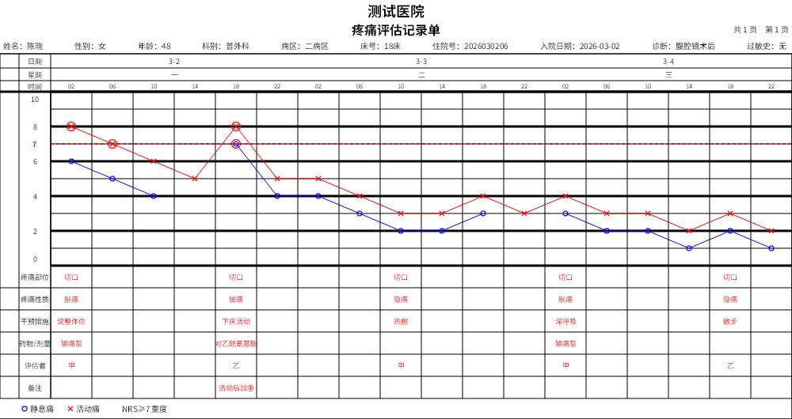

**Template** `PainChartTemplate` · **Document** `PainChartDocument` · **Sample** `demo/OODD.Charts.Demo.Common/PainSample.cs`

The NRS axis runs 0–10 at 22 px per point with a heavy rule on even scores; resting and activity pain are separate `PointSeries` on `PainChartTemplate.AxisNrs`. At or above 7 the template draws the dashed threshold and rings severe points in red, and unmeasured slots break the polyline instead of being filled with zeros. Each day has six assessment times (02/06/10/14/18/22) at 52 px per column, with accessory rows for site, character, intervention, medication and assessor.

```csharp
using System;
using System.IO;
using OODD.Charts;
using OODD.Charts.Medical.Pain;
using OODD.Charts.Model;
using SkiaSharp;

PainChartDocument doc = new PainChartDocument { HospitalName = "测试医院", FormTitle = "疼痛评估记录单" };
doc.Patient.Name = "陈晓";
doc.Days.Add(new ChartGroup(new DateTime(2026, 3, 2)));
PointSeries rest = new PointSeries("rest", PainChartTemplate.AxisNrs)
{
    Symbol = MarkerSymbol.Ring,
    Color = SKColors.Blue,
};
rest.Values[0] = 6;
rest.Values[1] = 8;
doc.Series.Add(rest);
doc.Cells.Add(new CellValue(PainFields.Site, 1, "切口"));
doc.Cells.Add(new CellValue(PainFields.Character, 1, "胀痛"));
using Chart chart = new Chart(doc, new PainChartTemplate());
File.WriteAllBytes("pain.png", chart.Encode(ChartImageFormat.Png, 96f));
```

### Protective restraint rounds record (保护性约束巡视记录单) · `restraint`

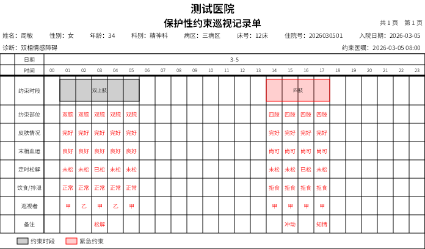

**Template** `RestraintChartTemplate` · **Document** `RestraintChartDocument` · **Sample** `demo/OODD.Charts.Demo.Common/RestraintSample.cs`

One day is 24 hourly slots with a Gantt-style restraint band across the top: `RestraintEpisode(start, endExclusive, text)` takes a half-open interval, `IsEmergency` switches to the highlight color, and the band is clipped page by page while the emergency mark is kept. Below it, each hour records restraint site, skin, distal circulation, scheduled release, basic care and the nurse on rounds — 26 px per column, 30 px per row, one hour per column with no merging.

```csharp
using System;
using System.IO;
using OODD.Charts;
using OODD.Charts.Medical.Restraint;
using OODD.Charts.Model;

RestraintChartDocument doc = new RestraintChartDocument { HospitalName = "测试医院", FormTitle = "保护性约束巡视记录单" };
doc.Patient.Name = "周敏";
doc.Patient.Department = "精神科";
doc.Days.Add(new ChartGroup(new DateTime(2026, 3, 5)));
doc.Episodes.Add(new RestraintEpisode(1, 6, "双上肢"));
doc.Episodes.Add(new RestraintEpisode(14, 18, "四肢") { IsEmergency = true });
doc.Cells.Add(new CellValue(RestraintFields.Skin, 2, "完好"));
doc.Cells.Add(new CellValue(RestraintFields.Nurse, 2, "甲"));
using Chart chart = new Chart(doc, new RestraintChartTemplate());
File.WriteAllBytes("restraint.png", chart.Encode(ChartImageFormat.Png, 96f));
```

### Transfusion reaction record (输血反应记录单) · `transfusion`

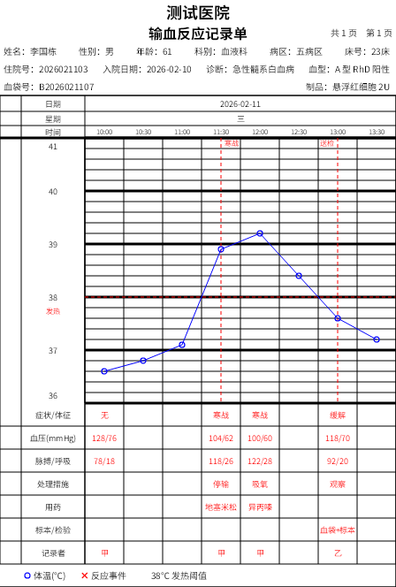

**Template** `TransfusionChartTemplate` · **Document** `TransfusionChartDocument` · **Sample** `demo/OODD.Charts.Demo.Common/TransfusionSample.cs`

The horizontal axis holds half-hour observation points counted from the start of infusion (8 slots by default) and the vertical axis spans 36–41 °C at 12 px per 0.2 °C. `Temperature` is a single curve owned by the document; the 38 °C fever threshold comes from `Scale.FeverThreshold` and is drawn as a red dashed line. Reaction events become red vertical lines through `EventMark`, with labels staggered above the band. Symptoms, blood pressure, pulse/respiration, treatment, medication and specimen are recorded per slot, and paging remaps slot numbers with them.

```csharp
using System;
using System.IO;
using OODD.Charts;
using OODD.Charts.Medical.Transfusion;
using OODD.Charts.Model;

TransfusionChartDocument doc = new TransfusionChartDocument { HospitalName = "测试医院", FormTitle = "输血反应记录单" };
doc.Patient.Name = "李国栋";
doc.Patient.Department = "血液科";
doc.Days.Add(new ChartGroup(new DateTime(2026, 2, 11)));
doc.Temperature.Values[0] = 36.6;
doc.Temperature.Values[3] = 38.9;
doc.Temperature.Values[4] = 39.2;
doc.Events.Add(new EventMark(3, "寒战"));
doc.Cells.Add(new CellValue(TransfusionFields.Symptoms, 3, "寒战"));
doc.Cells.Add(new CellValue(TransfusionFields.BloodPressure, 3, "104/62"));
using Chart chart = new Chart(doc, new TransfusionChartTemplate());
File.WriteAllBytes("transfusion.png", chart.Encode(ChartImageFormat.Png, 96f));
```

### Hyperbaric chamber companion record (高压氧治疗陪舱记录单) · `hyperbaric-companion`

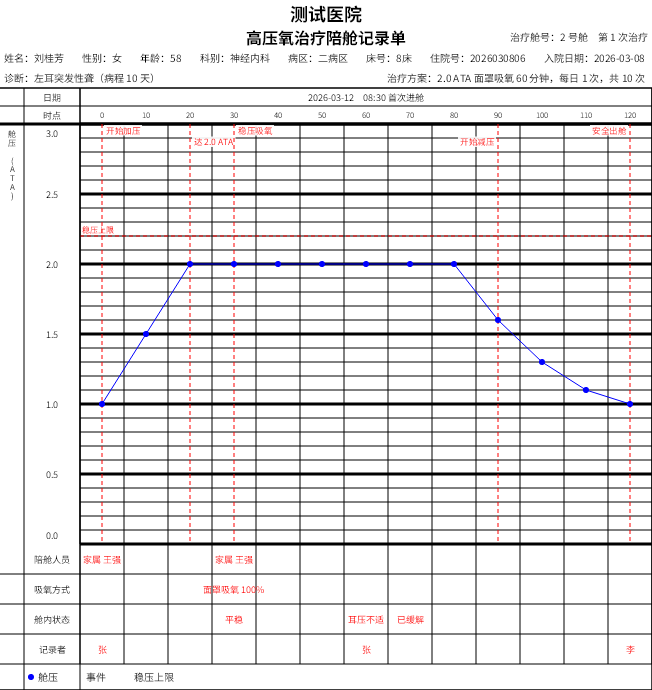

**Template** `HyperbaricCompanionTemplate` · **Document** `HyperbaricCompanionDocument` · **Sample** `demo/OODD.Charts.Demo.Common/HyperbaricCompanionSample.cs`

A `TimelineFormTemplate` instance: the engine fixes the time band and value axis, the document only supplies parameters: the engine fixes the date/time band, the numeric grid and the accessory rows, and `HyperbaricCompanionDocument` only declares a 0–3.0 ATA axis, one slot per 10 minutes and four accessory rows. The chamber-pressure curve lands on `AxisPressure` and naturally forms the compression–soak–decompression polyline; `ThresholdMark` draws the soak ceiling while `EventMark` marks pressurization, reaching depth, start of decompression and safe exit. The grid is 0.1 ATA per cell and 0.5 ATA per heavy rule.

```csharp
using System;
using System.IO;
using OODD.Charts;
using OODD.Charts.Medical.Forms;
using OODD.Charts.Medical.HyperbaricCompanion;
using OODD.Charts.Model;
using SkiaSharp;

HyperbaricCompanionDocument doc = new HyperbaricCompanionDocument { HospitalName = "测试医院" };
doc.Patient.Name = "刘桂芳";
doc.Days.Add(new ChartGroup(new DateTime(2026, 3, 12)) { DateText = "2026-03-12 08:30 首次进舱" });
PointSeries pressure = new PointSeries("pressure", HyperbaricCompanionRows.AxisPressure);
pressure.Color = SKColors.Blue;
pressure.Values[0] = 1.0;
pressure.Values[2] = 2.0;
pressure.Values[9] = 2.0;
pressure.Values[12] = 1.0;
doc.Series.Add(pressure);
doc.Thresholds.Add(new ThresholdMark(2.2, "稳压上限") { Color = SKColors.Red });
doc.Cells.Add(new CellValue(HyperbaricCompanionRows.Status, 6, "耳压不适"));
using Chart chart = new Chart(doc, new HyperbaricCompanionTemplate());
File.WriteAllBytes("hyperbaric-companion.png", chart.Encode(ChartImageFormat.Png, 96f));
```

### Hyperbaric pre-chamber education record (高压氧进舱宣教记录单) · `hyperbaric-education`

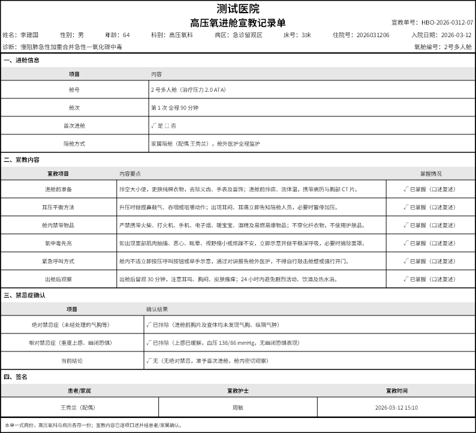

**Template** `HyperbaricEducationTemplate` · **Document** `HyperbaricEducationDocument` · **Sample** `demo/OODD.Charts.Demo.Common/HyperbaricEducationSample.cs`

Another `FormSheetTemplate` instance. Nothing in the template is specific to this form: the engine supplies the header, section titles, column headers and merged notes, and the document declares only four sections (entry information, teaching content, contraindication check, signatures). The teaching section has three columns; long sentences wrap greedily for mixed Chinese/Latin text and the row grows with the actual line count, so a three-line entry never invades the next row. Check marks use √ and □ because Microsoft YaHei / SimSun carry no ☑ or ☐ glyphs and would render tofu boxes.

```csharp
using System.IO;
using OODD.Charts;
using OODD.Charts.Medical.HyperbaricEducation;

HyperbaricEducationDocument doc = new HyperbaricEducationDocument { HospitalName = "测试医院" };
doc.Patient.Name = "李建国";
doc.Patient.Department = "高压氧科";
doc.SetCell(HyperbaricEducationSections.Info, HyperbaricEducationRows.Cabin, 1, "2 号多人舱（2.0 ATA）");
doc.SetCell(HyperbaricEducationSections.Info, HyperbaricEducationRows.Escort, 1, "家属陪舱（配偶 王秀兰）");
doc.SetCell(HyperbaricEducationSections.Teaching, HyperbaricEducationRows.EarPressure, 1,
    "升压时做捏鼻鼓气、吞咽或咀嚼动作；出现耳闷、耳痛立即告知陪舱人员。");
doc.SetCell(HyperbaricEducationSections.Teaching, HyperbaricEducationRows.EarPressure, 2, "√ 已掌握");
doc.SetCell(HyperbaricEducationSections.Contraindication, HyperbaricEducationRows.Absolute, 1, "√ 已排除（无气胸）");
using Chart chart = new Chart(doc, new HyperbaricEducationTemplate());
File.WriteAllBytes("hyperbaric-education.png", chart.Encode(ChartImageFormat.Png, 96f));
```

### Neurosurgery hyperbaric transfer record (神经外科高压氧疗接送记录单) · `neurosurgery-hyperbaric-transfer`

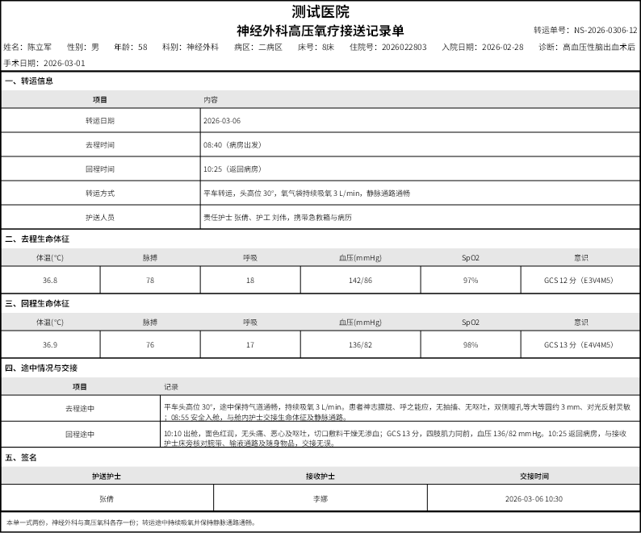

**Template** `HyperbaricTransferTemplate` · **Document** `HyperbaricTransferDocument` · **Sample** `demo/OODD.Charts.Demo.Common/HyperbaricTransferSample.cs`

The table engine again — `FormSheetTemplate` only reads the sections and columns declared by the document: Two layouts share one page: the outbound and inbound legs are each a six-column vital-sign table (temperature, pulse, respiration, blood pressure, SpO2, consciousness), while the en-route notes are full-width prose cells. Transfer times and transport mode sit in a two-column item/content section, and long handover notes grow with their line count so the signature block is never pushed off the sheet. Sections and column weights are fixed once in the document.

```csharp
using System.IO;
using OODD.Charts;
using OODD.Charts.Medical.HyperbaricTransfer;

HyperbaricTransferDocument doc = new HyperbaricTransferDocument { HospitalName = "测试医院" };
doc.Patient.Name = "陈立军";
doc.Patient.Department = "神经外科";
doc.SetCell(HyperbaricTransferSections.Transfer, HyperbaricTransferRows.OutboundTime, 1, "08:40（病房出发）");
doc.SetCell(HyperbaricTransferSections.Transfer, HyperbaricTransferRows.ReturnTime, 1, "10:25（返回病房）");
doc.SetCell(HyperbaricTransferSections.Outbound, HyperbaricTransferRows.OutboundVital, 0, "36.8");
doc.SetCell(HyperbaricTransferSections.Outbound, HyperbaricTransferRows.OutboundVital, 3, "142/86");
doc.SetCell(HyperbaricTransferSections.Inbound, HyperbaricTransferRows.InboundVital, 3, "136/82");
doc.SetCell(HyperbaricTransferSections.Handover, HyperbaricTransferRows.InboundNote, 1,
    "10:10 出舱，无头痛、恶心，切口敷料干燥；10:25 返回病房，床旁核对腕带与输液通路。");
using Chart chart = new Chart(doc, new HyperbaricTransferTemplate());
File.WriteAllBytes("neurosurgery-hyperbaric-transfer.png", chart.Encode(ChartImageFormat.Png, 96f));
```

### Code Blue resuscitation record (Code Blue 抢救记录本) · `code-blue`


**Template** `CodeBlueTemplate` · **Document** `CodeBlueDocument` · **Sample** `demo/OODD.Charts.Demo.Common/CodeBlueSample.cs`

The other timeline form engine, `TimelineFormTemplate`. Even the side rows are data: minutes 0–60 with one slot per 5 minutes, heart rate and systolic pressure sharing a single 20–200 axis, both series set to `Connect = false` so measured points are not joined into a trend that was never recorded. `ThresholdMark(90, ...)` draws the hypoperfusion line, and `EventMark` records arrest, epinephrine, defibrillation and return of spontaneous circulation with labels staggered to avoid overlap. Rhythm, drugs, shocks/procedures and recorder fill four accessory rows slot by slot.

```csharp
using System;
using System.IO;
using OODD.Charts;
using OODD.Charts.Medical.CodeBlue;
using OODD.Charts.Medical.Forms;
using OODD.Charts.Model;
using SkiaSharp;

CodeBlueDocument doc = new CodeBlueDocument { HospitalName = "测试医院" };
doc.Patient.Name = "赵国强";
doc.Days.Add(new ChartGroup(new DateTime(2026, 3, 9)) { DateText = "14:32 心搏骤停，启动 Code Blue" });
PointSeries heartRate = new PointSeries("hr", CodeBlueRows.AxisVital);
heartRate.Color = SKColors.Red;
heartRate.Connect = false;
heartRate.Values[0] = 128;
heartRate.Values[3] = 150;
doc.Series.Add(heartRate);
doc.Thresholds.Add(new ThresholdMark(90, "低灌注") { Color = SKColors.Red });
doc.Events.Add(new EventMark(3, "除颤 200J") { Color = SKColors.Red });
doc.Cells.Add(new CellValue(CodeBlueRows.Rhythm, 0, "室颤"));
using Chart chart = new Chart(doc, new CodeBlueTemplate());
File.WriteAllBytes("code-blue.png", chart.Encode(ChartImageFormat.Png, 96f));
```

### Patient-controlled analgesia record (患者自控镇痛（PCA）记录单) · `pca`

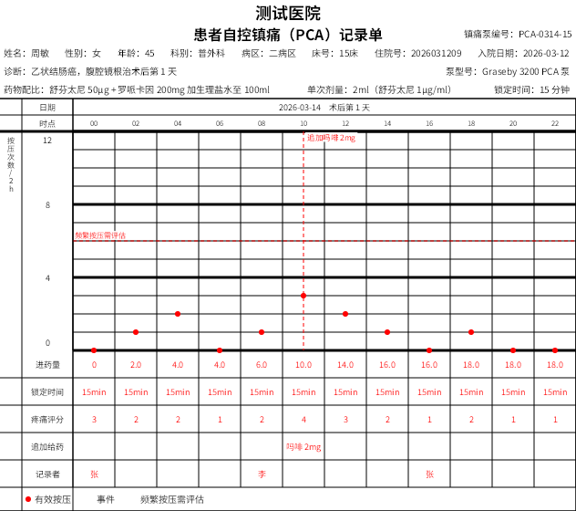

**Template** `PcaTemplate` · **Document** `PcaDocument` · **Sample** `demo/OODD.Charts.Demo.Common/PcaSample.cs`

This one runs on `TimelineFormTemplate` — once more, no drawing code: time starts at return from the operating room, one slot per 2 hours, and the vertical axis counts effective bolus presses per 2 hours (0–12). `ThresholdMark(6, ...)` marks the frequent-press boundary and `EventMark` logs rescue doses. Accessory rows record cumulative volume, lockout time, NRS and recorder; pump model, drug mixture, bolus size and lockout time are written as header extra fields instead of taking table rows.

```csharp
using System;
using System.IO;
using OODD.Charts;
using OODD.Charts.Medical.Forms;
using OODD.Charts.Medical.Pca;
using OODD.Charts.Model;
using SkiaSharp;

PcaDocument doc = new PcaDocument { HospitalName = "测试医院" };
doc.Patient.Name = "林静";
doc.Days.Add(new ChartGroup(new DateTime(2026, 3, 14)) { DateText = "2026-03-14 术后第 1 天" });
PointSeries presses = new PointSeries("presses", PcaRows.AxisPresses);
presses.Color = SKColors.Red;
presses.Connect = false;
presses.Values[1] = 2;
presses.Values[5] = 3;
doc.Series.Add(presses);
doc.Thresholds.Add(new ThresholdMark(6, "频繁按压需评估"));
doc.Cells.Add(new CellValue(PcaRows.Volume, 5, "10.0"));
doc.Events.Add(new EventMark(5, "追加吗啡 2mg"));
using Chart chart = new Chart(doc, new PcaTemplate());
File.WriteAllBytes("pca.png", chart.Encode(ChartImageFormat.Png, 96f));
```

### APACHE II score sheet (APACHE II 评分表) · `apache-ii`

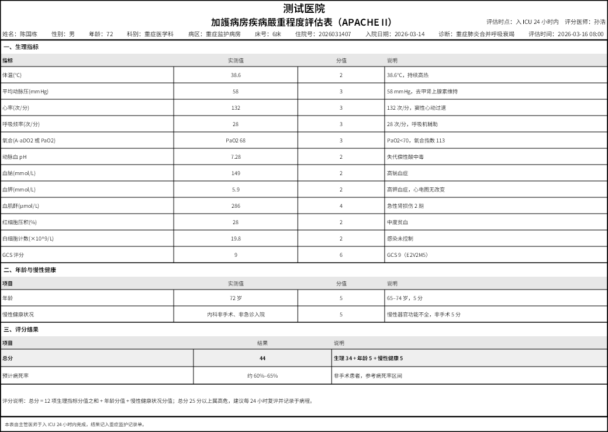

**Template** `ApacheIiTemplate` · **Document** `ApacheIiDocument` · **Sample** `demo/OODD.Charts.Demo.Common/ApacheIiSample.cs`

This one is plain `FormSheetTemplate` too, with zero rendering code and all content in the document: three sections cover the 12 physiological variables, age plus chronic health, and the result block, each row with four columns (item / measured value / points / note), and the total row is highlighted by `IsTotal`. `SetCell(section, row, column, text)` edits text by section and row keys without touching geometry, so the order and column widths of the 12 rows are fixed once in the document and the clinician only fills in numbers.

```csharp
using System.IO;
using OODD.Charts;
using OODD.Charts.Medical.ApacheIi;

ApacheIiDocument doc = new ApacheIiDocument { HospitalName = "测试医院" };
doc.Patient.Name = "陈国栋";
doc.Patient.Department = "重症医学科";
doc.SetCell(ApacheIiSections.Physiology, "temperature", 1, "38.6");
doc.SetCell(ApacheIiSections.Physiology, "temperature", 2, "2");
doc.SetCell(ApacheIiSections.Physiology, "gcs", 1, "9");
doc.SetCell(ApacheIiSections.Physiology, "gcs", 2, "6");
doc.SetCell(ApacheIiSections.Chronic, "age", 1, "72 岁");
doc.SetCell(ApacheIiSections.Chronic, "age", 2, "5");
doc.SetCell(ApacheIiSections.Result, "total", 1, "44");
using Chart chart = new Chart(doc, new ApacheIiTemplate());
File.WriteAllBytes("apache-ii.png", chart.Encode(ChartImageFormat.Png, 96f));
```

### Surgical safety checklist (手术安全核查表) · `surgical-safety-checklist`

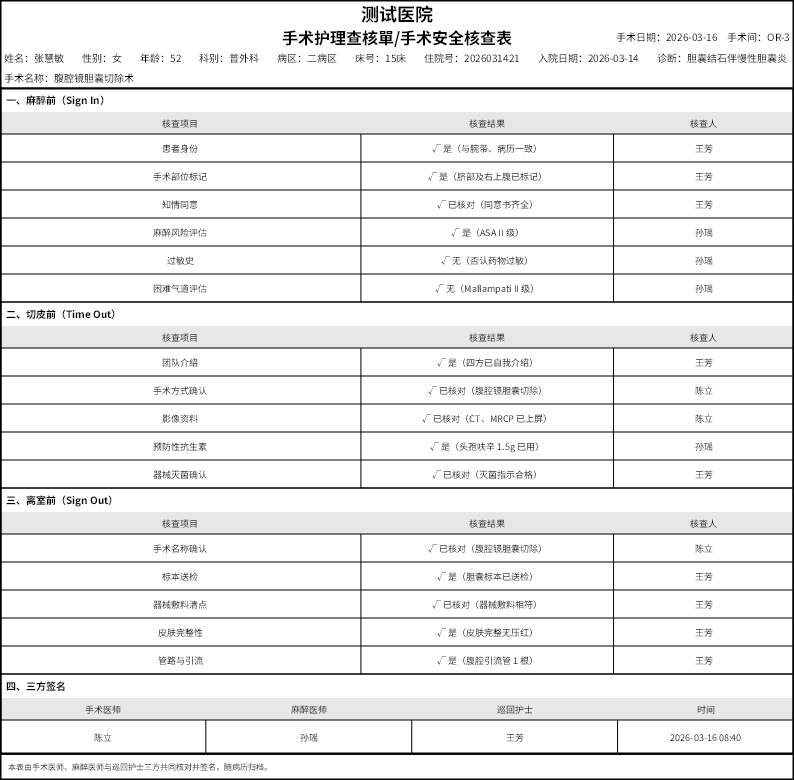

**Template** `SurgicalSafetyChecklistTemplate` · **Document** `SurgicalSafetyChecklistDocument` · **Sample** `demo/OODD.Charts.Demo.Common/SurgicalSafetyChecklistSample.cs`

One more `FormSheetTemplate`: the engine draws the header and columns, the caller only supplies text: Sign In, Time Out and Sign Out are three three-column tables (item / result / checker), followed by a four-way signature block. Row keys are fixed in the document (`PatientIdentity`, `Procedure`, `Counts` and so on), so application code only fills results and signatures; check marks use √ rather than ☑ for the same font reason as the education sheet.

```csharp
using System.IO;
using OODD.Charts;
using OODD.Charts.Medical.SurgicalSafetyChecklist;

SurgicalSafetyChecklistDocument doc = new SurgicalSafetyChecklistDocument { HospitalName = "测试医院" };
doc.Patient.Name = "张慧敏";
doc.Patient.Department = "普外科";
doc.SetCell(SurgicalSafetyChecklistSections.SignIn, SurgicalSafetyChecklistRows.PatientIdentity, 1, "√ 是（与腕带一致）");
doc.SetCell(SurgicalSafetyChecklistSections.SignIn, SurgicalSafetyChecklistRows.PatientIdentity, 2, "王芳");
doc.SetCell(SurgicalSafetyChecklistSections.TimeOut, SurgicalSafetyChecklistRows.Procedure, 1, "√ 已核对（腹腔镜胆囊切除）");
doc.SetCell(SurgicalSafetyChecklistSections.TimeOut, SurgicalSafetyChecklistRows.Procedure, 2, "陈立");
doc.SetCell(SurgicalSafetyChecklistSections.SignOut, SurgicalSafetyChecklistRows.Counts, 1, "√ 已核对（器械敷料相符）");
doc.SetCell(SurgicalSafetyChecklistSections.Signature, SurgicalSafetyChecklistRows.Sign, 0, "陈立");
using Chart chart = new Chart(doc, new SurgicalSafetyChecklistTemplate());
File.WriteAllBytes("surgical-safety-checklist.png", chart.Encode(ChartImageFormat.Png, 96f));
```

### TCM syndrome-based nursing record (中医专病辨证施护护理记录单) · `tcm-syndrome-nursing`

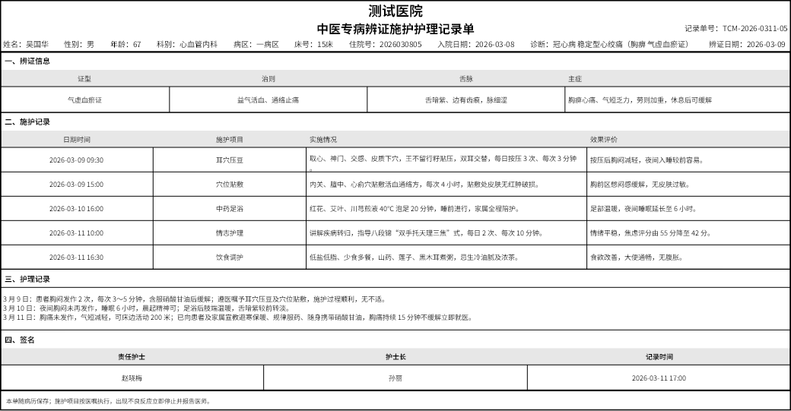

**Template** `TcmNursingTemplate` · **Document** `TcmNursingDocument` · **Sample** `demo/OODD.Charts.Demo.Common/TcmNursingSample.cs`

Built on the table engine. Sections, column widths and merged notes are declared in the document: syndrome information has four columns (pattern / principle / tongue and pulse / main symptoms), nursing measures have four columns (date-time / measure / implementation / effect), and the nursing narrative is one full-width `Note`. Measure entries are usually written as a full sentence; the engine wraps mixed Chinese/Latin text and raises the row height, so a three-line entry never squeezes out the next one.

```csharp
using System.IO;
using OODD.Charts;
using OODD.Charts.Medical.TcmNursing;

TcmNursingDocument doc = new TcmNursingDocument { HospitalName = "测试医院" };
doc.Patient.Name = "吴国华";
doc.Patient.Department = "心血管内科";
doc.SetCell(TcmNursingSections.Syndrome, TcmNursingRows.Pattern, 0, "气虚血瘀证");
doc.SetCell(TcmNursingSections.Syndrome, TcmNursingRows.Pattern, 1, "益气活血、通络止痛");
doc.SetCell(TcmNursingSections.Measures, TcmNursingRows.Auricular, 0, "2026-03-09 09:30");
doc.SetCell(TcmNursingSections.Measures, TcmNursingRows.Auricular, 2,
    "取心、神门、交感、皮质下穴，王不留行籽贴压，双耳交替，每日按压 3 次。");
doc.Section(TcmNursingSections.Notes)!.Note = "3 月 9 日：胸闷发作 2 次，含服硝酸甘油后缓解。";
using Chart chart = new Chart(doc, new TcmNursingTemplate());
File.WriteAllBytes("tcm-syndrome-nursing.png", chart.Encode(ChartImageFormat.Png, 96f));
```

### Cancer psychology consultation reply (癌症心理服务会诊回复) · `cancer-psychology-consult`

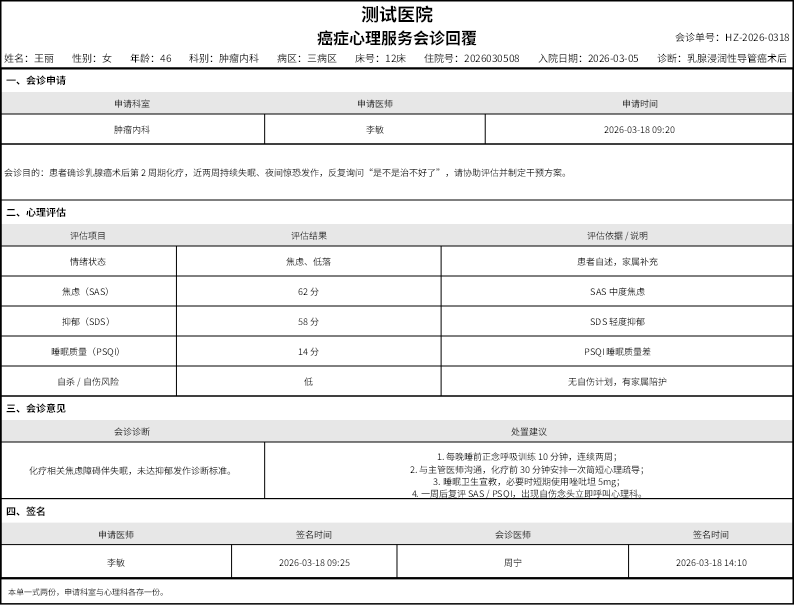

**Template** `CancerPsychologyConsultTemplate` · **Document** `CancerPsychologyConsultDocument` · **Sample** `demo/OODD.Charts.Demo.Common/CancerPsychologyConsultSample.cs`

No template class of its own — a direct `FormSheetTemplate` composition: application, assessment, opinion and signature sections. The application section is a three-column table plus a merged note, the assessment section records each scale score with its basis, and the second column of the opinion section holds a numbered list (`\n` separated, height follows the line count). Consultation number and diagnosis go into the header extra fields instead of table rows.

```csharp
using System.IO;
using OODD.Charts;
using OODD.Charts.Medical.CancerPsychologyConsult;

CancerPsychologyConsultDocument doc = new CancerPsychologyConsultDocument { HospitalName = "测试医院" };
doc.Patient.Name = "王丽";
doc.Patient.Department = "肿瘤内科";
doc.SetCell(CancerPsychologyConsultSections.Application, "basic", 0, "肿瘤内科");
doc.SetCell(CancerPsychologyConsultSections.Application, "basic", 2, "2026-03-18 09:20");
doc.Section(CancerPsychologyConsultSections.Application)!.Note =
    "会诊目的：术后化疗期间持续失眠、夜间惊恐发作，请协助评估并制定干预方案。";
doc.SetCell(CancerPsychologyConsultSections.Assessment, "anxiety", 1, "62 分");
doc.SetCell(CancerPsychologyConsultSections.Assessment, "anxiety", 2, "SAS 中度焦虑");
doc.SetCell(CancerPsychologyConsultSections.Opinion, "diagnosis", 1, "每晚睡前正念呼吸训练 10 分钟，一周后复评 SAS。");
using Chart chart = new Chart(doc, new CancerPsychologyConsultTemplate());
File.WriteAllBytes("cancer-psychology-consult.png", chart.Encode(ChartImageFormat.Png, 96f));
```

### Body composition report (健检身体组成分析检查报告) · `body-composition`

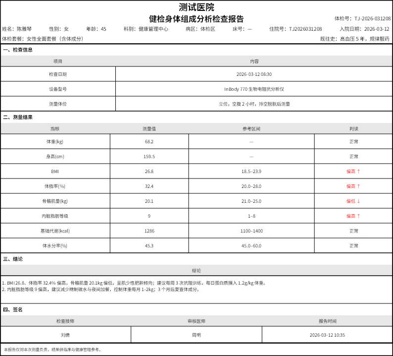

**Template** `BodyCompositionTemplate` · **Document** `BodyCompositionDocument` · **Sample** `demo/OODD.Charts.Demo.Common/BodyCompositionSample.cs`

Still `FormSheetTemplate`; only the sections and data change: the results section has four columns (indicator / measured value / reference range / interpretation). Abnormal flags are not decided by the template — application code turns that cell red with `doc.Row(section, row)!.Cells[3].Color`. Examination information, conclusion and signatures each own a section, and the conclusion is a full-width merged note.

```csharp
using System.IO;
using OODD.Charts;
using OODD.Charts.Medical.BodyComposition;
using SkiaSharp;

BodyCompositionDocument doc = new BodyCompositionDocument { HospitalName = "测试医院" };
doc.Patient.Name = "陈雅琴";
doc.Patient.Department = "健康管理中心";
doc.SetCell(BodyCompositionSections.Info, BodyCompositionRows.Device, 1, "InBody 770 生物电阻抗分析仪");
doc.SetCell(BodyCompositionSections.Results, BodyCompositionRows.Weight, 1, "68.2");
doc.SetCell(BodyCompositionSections.Results, BodyCompositionRows.BodyFat, 1, "32.4");
doc.SetCell(BodyCompositionSections.Results, BodyCompositionRows.BodyFat, 3, "偏高 ↑");
doc.Row(BodyCompositionSections.Results, BodyCompositionRows.BodyFat)!.Cells[3].Color = SKColors.Red;
doc.Section(BodyCompositionSections.Conclusion)!.Note = "体脂率偏高、骨骼肌量偏低，呈肌少性肥胖倾向。";
using Chart chart = new Chart(doc, new BodyCompositionTemplate());
File.WriteAllBytes("body-composition.png", chart.Encode(ChartImageFormat.Png, 96f));
```

### Limb blood flow and pressure report (四肢血流探测及压力测量检查报告) · `limb-blood-flow`

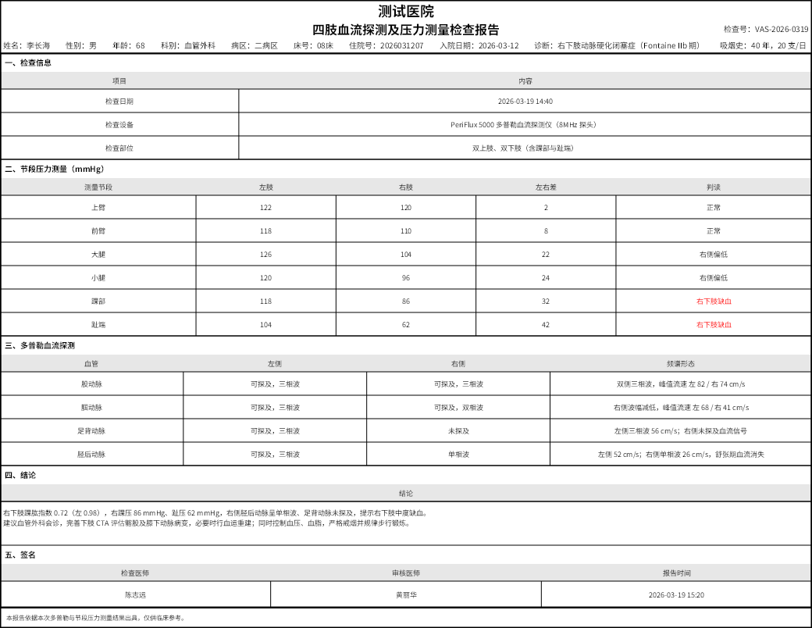

**Template** `LimbBloodFlowTemplate` · **Document** `LimbBloodFlowDocument` · **Sample** `demo/OODD.Charts.Demo.Common/LimbBloodFlowSample.cs`

Another `FormSheetTemplate` instance. Nothing in the template is specific to this form: segmental pressures are six rows by five columns (segment / left limb / right limb / side difference / interpretation) and Doppler findings are four rows by four columns (vessel / left / right / spectral pattern). Left-right comparison lives in columns rather than in two separate tables, so the difference column can be read directly; abnormal interpretations are marked through `Cells[4].Color`. Conclusion and signatures take their own sections.

```csharp
using System.IO;
using OODD.Charts;
using OODD.Charts.Medical.LimbBloodFlow;
using SkiaSharp;

LimbBloodFlowDocument doc = new LimbBloodFlowDocument { HospitalName = "测试医院" };
doc.Patient.Name = "李长海";
doc.Patient.Department = "血管外科";
doc.SetCell(LimbBloodFlowSections.Pressure, LimbBloodFlowRows.UpperArm, 1, "122");
doc.SetCell(LimbBloodFlowSections.Pressure, LimbBloodFlowRows.UpperArm, 2, "120");
doc.SetCell(LimbBloodFlowSections.Pressure, LimbBloodFlowRows.Ankle, 1, "118");
doc.SetCell(LimbBloodFlowSections.Pressure, LimbBloodFlowRows.Ankle, 2, "86");
doc.SetCell(LimbBloodFlowSections.Pressure, LimbBloodFlowRows.Ankle, 3, "32");
doc.SetCell(LimbBloodFlowSections.Pressure, LimbBloodFlowRows.Ankle, 4, "右下肢缺血");
doc.Row(LimbBloodFlowSections.Pressure, LimbBloodFlowRows.Ankle)!.Cells[4].Color = SKColors.Red;
doc.SetCell(LimbBloodFlowSections.Doppler, LimbBloodFlowRows.DorsalisPedis, 2, "未探及");
using Chart chart = new Chart(doc, new LimbBloodFlowTemplate());
File.WriteAllBytes("limb-blood-flow.png", chart.Encode(ChartImageFormat.Png, 96f));
```

### Inventory book (点物本) · `inventory-book`

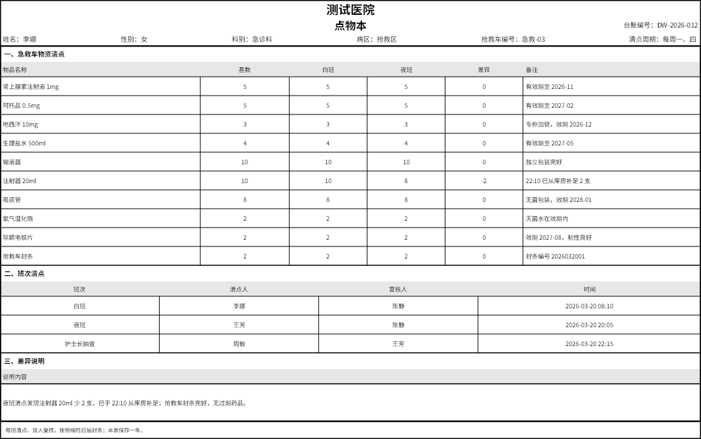

**Template** `InventoryBookTemplate` · **Document** `InventoryBookDocument` · **Sample** `demo/OODD.Charts.Demo.Common/InventoryBookSample.cs`

The table engine again — `FormSheetTemplate` only reads the sections and columns declared by the document: the supply section has six columns (item / par level / day shift / night shift / difference / remark), the difference column accepts negative numbers where the sign is the shortfall, and the remark records when stock was replenished. A second section logs counter, checker and time per shift, and a third is one full-width variance note. Row keys are constants, so adding or removing an item is an add/remove row in the document.

```csharp
using System.IO;
using OODD.Charts;
using OODD.Charts.Medical.InventoryBook;

InventoryBookDocument doc = new InventoryBookDocument { HospitalName = "测试医院" };
doc.Patient.Name = "李娜";
doc.Patient.Department = "急诊科";
doc.SetCell(InventoryBookSections.Items, InventoryBookRows.Epinephrine, 1, "5");
doc.SetCell(InventoryBookSections.Items, InventoryBookRows.Epinephrine, 2, "5");
doc.SetCell(InventoryBookSections.Items, InventoryBookRows.Epinephrine, 3, "5");
doc.SetCell(InventoryBookSections.Items, InventoryBookRows.Syringe, 3, "8");
doc.SetCell(InventoryBookSections.Items, InventoryBookRows.Syringe, 4, "-2");
doc.SetCell(InventoryBookSections.Items, InventoryBookRows.Syringe, 5, "22:10 已从库房补足 2 支");
doc.SetCell(InventoryBookSections.Shifts, InventoryBookRows.DayShift, 1, "李娜");
doc.SetCell(InventoryBookSections.Shifts, InventoryBookRows.DayShift, 3, "2026-03-20 08:10");
using Chart chart = new Chart(doc, new InventoryBookTemplate());
File.WriteAllBytes("inventory-book.png", chart.Encode(ChartImageFormat.Png, 96f));
```

### Workload tally book (工作量统计本) · `workload-book`

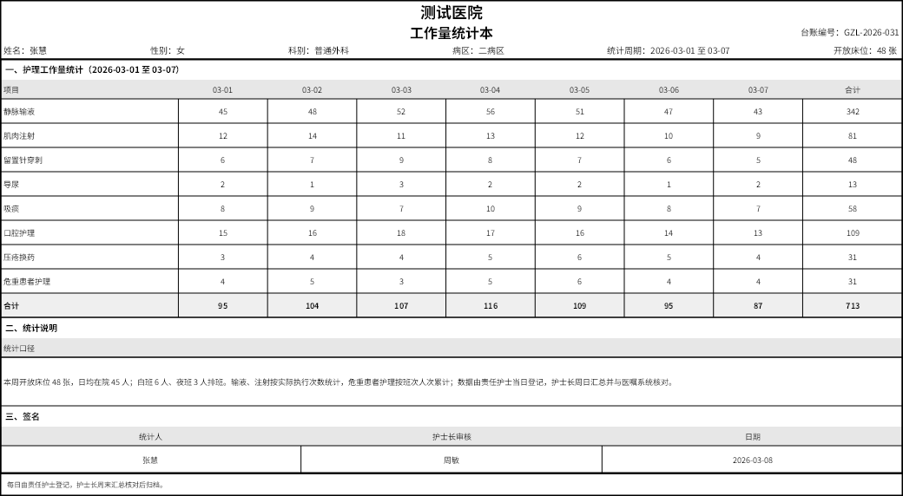

**Template** `WorkloadBookTemplate` · **Document** `WorkloadBookDocument` · **Sample** `demo/OODD.Charts.Demo.Common/WorkloadBookSample.cs`

This one is plain `FormSheetTemplate` too, with zero rendering code and all content in the document: eight nursing items by seven days form a fixed-column matrix, column 8 is the row total, and the last row's `IsTotal` draws the daily and grand totals. The seven dates are written into the column headers when the document is constructed, `SetCell` only changes the numbers, and totals have to be computed by the caller before they are written.

```csharp
using System.IO;
using OODD.Charts;
using OODD.Charts.Medical.WorkloadBook;
using OODD.Charts.Model;

WorkloadBookDocument doc = new WorkloadBookDocument { HospitalName = "测试医院" };
doc.Patient.Department = "普通外科";
doc.Patient.ExtraFields.Add(new HeaderField("period", "统计周期", "2026-03-01 至 03-07"));
doc.SetCell(WorkloadBookSections.Workload, WorkloadBookRows.Intravenous, 1, "45");
doc.SetCell(WorkloadBookSections.Workload, WorkloadBookRows.Intravenous, 2, "48");
doc.SetCell(WorkloadBookSections.Workload, WorkloadBookRows.Intravenous, 8, "93");
doc.SetCell(WorkloadBookSections.Workload, WorkloadBookRows.Total, 1, "91");
doc.SetCell(WorkloadBookSections.Workload, WorkloadBookRows.Total, 8, "182");
doc.Section(WorkloadBookSections.Notes)!.Note = "按实际执行次数统计，与医嘱系统核对后汇总。";
using Chart chart = new Chart(doc, new WorkloadBookTemplate());
File.WriteAllBytes("workload-book.png", chart.Encode(ChartImageFormat.Png, 96f));
```

### Adverse event register (不良事件登记本) · `adverse-event-book`

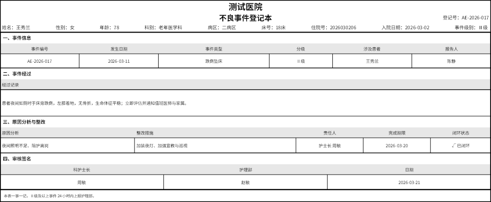

**Template** `AdverseEventBookTemplate` · **Document** `AdverseEventBookDocument` · **Sample** `demo/OODD.Charts.Demo.Common/AdverseEventBookSample.cs`

One more `FormSheetTemplate`: the engine draws the header and columns, the caller only supplies text: event information has six columns (number / date / type / grade / patient / reporter), the course is a full-width `Note`, and cause analysis plus corrective action has five columns (cause / action / owner / due date / closure). Long sentences in the course and action cells grow with their line count and never push neighbouring rows off the sheet.

```csharp
using System.IO;
using OODD.Charts;
using OODD.Charts.Medical.AdverseEventBook;

AdverseEventBookDocument doc = new AdverseEventBookDocument { HospitalName = "测试医院" };
doc.Patient.Name = "王秀兰";
doc.Patient.Department = "老年医学科";
doc.SetCell(AdverseEventBookSections.Event, AdverseEventBookRows.Event, 0, "AE-2026-017");
doc.SetCell(AdverseEventBookSections.Event, AdverseEventBookRows.Event, 2, "跌倒坠床");
doc.SetCell(AdverseEventBookSections.Event, AdverseEventBookRows.Event, 3, "Ⅱ级");
doc.Section(AdverseEventBookSections.Course)!.Note = "患者夜间如厕时于床旁跌倒，左膝着地，无骨折，生命体征平稳。";
doc.SetCell(AdverseEventBookSections.Analysis, AdverseEventBookRows.Corrective, 0, "夜间照明不足、陪护离岗");
doc.SetCell(AdverseEventBookSections.Analysis, AdverseEventBookRows.Corrective, 1, "加装夜灯、加强巡视");
doc.SetCell(AdverseEventBookSections.Analysis, AdverseEventBookRows.Corrective, 4, "√ 已闭环");
using Chart chart = new Chart(doc, new AdverseEventBookTemplate());
File.WriteAllBytes("adverse-event-book.png", chart.Encode(ChartImageFormat.Png, 96f));
```

### Postmortem care / body transfer record (尸体护理/遗体转运记录) · `postmortem-care`

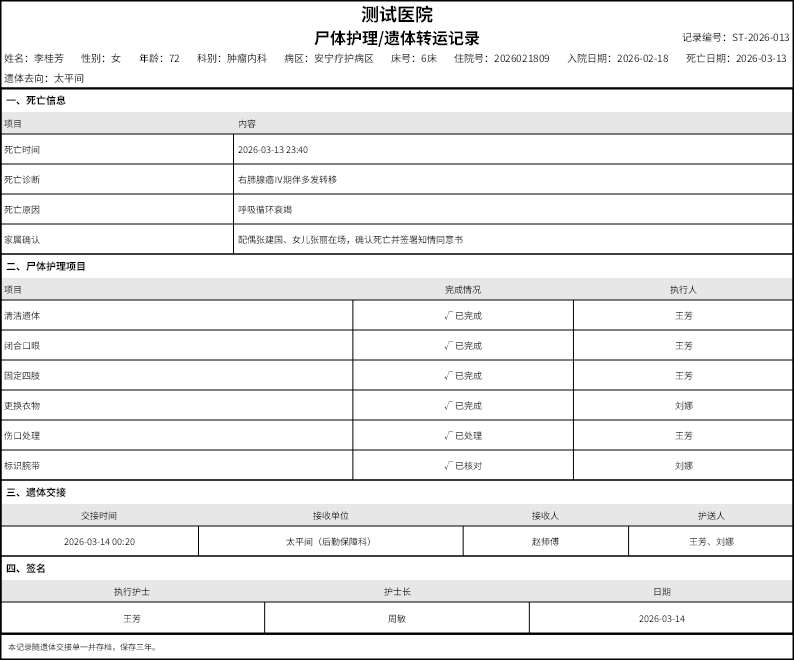

**Template** `PostmortemCareTemplate` · **Document** `PostmortemCareDocument` · **Sample** `demo/OODD.Charts.Demo.Common/PostmortemCareSample.cs`

Built on the table engine. Sections, column widths and merged notes are declared in the document: death information is two columns (item / content), the six care items are three columns (item / status / executor), and the handover is four columns (time / receiving unit / receiver / escort). Each care item is ticked (√ done / √ handled / √ verified), and the signature section holds the nurse, the head nurse and the date.

```csharp
using System.IO;
using OODD.Charts;
using OODD.Charts.Medical.PostmortemCare;

PostmortemCareDocument doc = new PostmortemCareDocument { HospitalName = "测试医院" };
doc.Patient.Name = "李桂芳";
doc.Patient.Department = "肿瘤内科";
doc.SetCell(PostmortemCareSections.Death, PostmortemCareRows.DeathTime, 1, "2026-03-13 23:40");
doc.SetCell(PostmortemCareSections.Death, PostmortemCareRows.Cause, 1, "呼吸循环衰竭");
doc.SetCell(PostmortemCareSections.Care, PostmortemCareRows.Clean, 1, "√ 已完成");
doc.SetCell(PostmortemCareSections.Care, PostmortemCareRows.Clean, 2, "王芳");
doc.SetCell(PostmortemCareSections.Handover, PostmortemCareRows.Handover, 1, "太平间（后勤保障科）");
doc.SetCell(PostmortemCareSections.Handover, PostmortemCareRows.Handover, 2, "赵师傅");
using Chart chart = new Chart(doc, new PostmortemCareTemplate());
File.WriteAllBytes("postmortem-care.png", chart.Encode(ChartImageFormat.Png, 96f));
```

### Organ donation process record (人体器官捐献过程记录表) · `organ-donation`

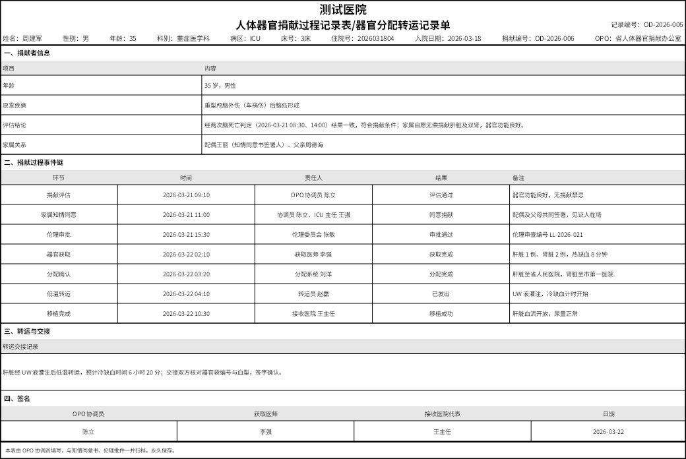

**Template** `OrganDonationTemplate` · **Document** `OrganDonationDocument` · **Sample** `demo/OODD.Charts.Demo.Common/OrganDonationSample.cs`

No template class of its own — a direct `FormSheetTemplate` composition: donor information is two columns, the event chain has five columns (step / time / owner / result / remark) across seven steps in chronological order, and transport plus handover is one merged note. Minute-level times and cold-ischemia remarks are just `SetCell` text and take no part in layout computation.

```csharp
using System.IO;
using OODD.Charts;
using OODD.Charts.Medical.OrganDonation;

OrganDonationDocument doc = new OrganDonationDocument { HospitalName = "测试医院" };
doc.Patient.Name = "周建军";
doc.Patient.Department = "重症医学科";
doc.SetCell(OrganDonationSections.Donor, OrganDonationRows.Disease, 1, "重型颅脑外伤后脑疝形成");
doc.SetCell(OrganDonationSections.Chain, OrganDonationRows.Consent, 1, "2026-03-21 11:00");
doc.SetCell(OrganDonationSections.Chain, OrganDonationRows.Consent, 2, "协调员 陈立");
doc.SetCell(OrganDonationSections.Chain, OrganDonationRows.Consent, 3, "同意捐献");
doc.SetCell(OrganDonationSections.Chain, OrganDonationRows.Procurement, 1, "2026-03-22 02:10");
doc.SetCell(OrganDonationSections.Chain, OrganDonationRows.Procurement, 3, "获取完成");
doc.Section(OrganDonationSections.Handover)!.Note = "肝脏经 UW 液灌注后低温转运，冷缺血时间 6 小时 20 分。";
using Chart chart = new Chart(doc, new OrganDonationTemplate());
File.WriteAllBytes("organ-donation.png", chart.Encode(ChartImageFormat.Png, 96f));
```

## Industry forms

### Engineering

#### Well log · `well-log`

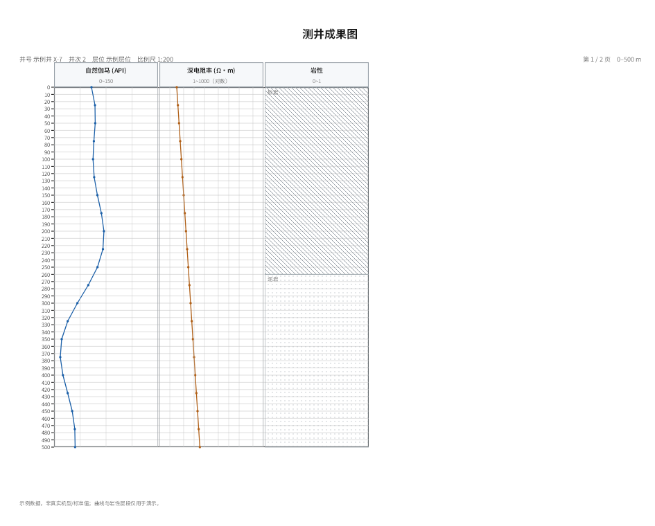

**Template** `WellLogChartTemplate` · **Document** `WellLogDocument` · **Sample** `demo/OODD.Charts.Demo.Common/EngineeringSamples.cs`

The depth axis increases downward while the tracks sit side by side and share it: natural gamma uses a 0–150 linear scale, deep resistivity a 1–1000 logarithmic scale, and the lithology track fills `PatternKind` intervals. `PageDepth` splits 0–1000 m into two pages and `PageIndex` selects one; each export contains that page only, with track headers and depth marks redrawn.

```csharp
using System;
using System.IO;
using OODD.Charts;
using OODD.Charts.Engineering.WellLog;

WellLogDocument doc = new WellLogDocument
{
    WellId = "示例井 X-7",
    RunNumber = "2",
    DepthTop = 0d,
    DepthBottom = 1000d,
    PageDepth = 500d,
};
WellLogTrack gr = new WellLogTrack("gr", "自然伽马 (API)", 0d, 150d, false);
gr.Samples.Add(new WellLogSample(120d, 68d));
gr.Samples.Add(new WellLogSample(240d, 54d));
doc.Tracks.Add(gr);
WellLogTrack res = new WellLogTrack("res", "深电阻率 (Ω·m)", 1d, 1000d, true);
res.Samples.Add(new WellLogSample(120d, 6d));
doc.Tracks.Add(res);
using Chart chart = new Chart(doc, new WellLogChartTemplate());
File.WriteAllBytes("well-log.png", chart.Encode(ChartImageFormat.Png, 96f));
```

#### Dissolved gas analysis (DGA) · `dga`

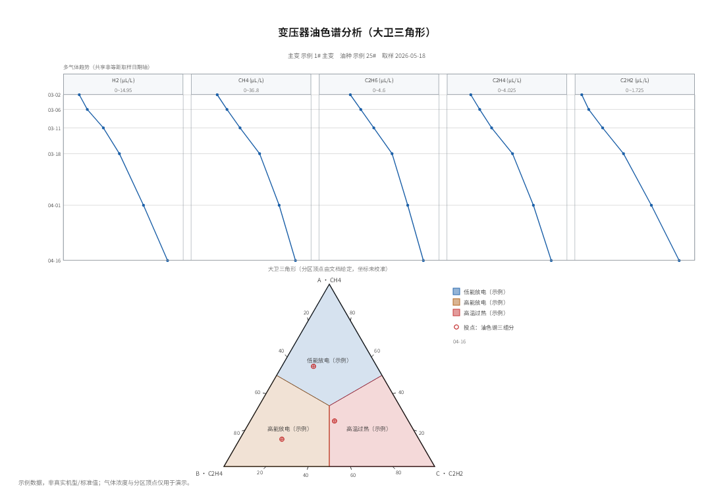

**Template** `DgaChartTemplate` · **Document** `DgaChartDocument` · **Sample** `demo/OODD.Charts.Demo.Common/EngineeringSamples.cs`

Five gas trend tracks share a non-uniform sampling axis measured in days, while the lower half is a Duval triangle with three reversed component axes; `TriaxialComponents` is mapped to pixels by barycentric coordinates. `DgaZone` polygons and `DgaSample` points come straight from the document, so the template carries no built-in fault-zone coordinates.

```csharp
using System;
using System.IO;
using OODD.Charts;
using OODD.Charts.Engineering.Dga;
using OODD.Charts.Geometry;

DgaChartDocument doc = new DgaChartDocument
{
    TransformerId = "示例 1# 主变",
    OilBrand = "示例 25#",
    SampleDateText = "2026-05-18",
};
DgaGasSeries h2 = new DgaGasSeries("h2", "H2", "μL/L");
h2.Samples.Add(new DgaGasSample(0d, "03-02", 2d));
h2.Samples.Add(new DgaGasSample(30d, "04-01", 10d));
doc.GasSeries.Add(h2);
doc.Samples.Add(new DgaSample("04-16", new TriaxialComponents(0.15d, 0.65d, 0.20d)));
using Chart chart = new Chart(doc, new DgaChartTemplate());
File.WriteAllBytes("dga.png", chart.Encode(ChartImageFormat.Png, 96f));
```

### Transit

#### Train graph · `train-graph`


**Template** `TrainGraphTemplate` · **Document** `TrainGraphDocument` · **Sample** `demo/OODD.Charts.Demo.Common/TransitSamples.cs`

The horizontal axis is a four-level time ruler (1/5/10/60 min) and the vertical axis holds station lines weighted by section running time, filling the plot height. A train path is an analytic slanted line between station boundaries plus a horizontal dwell segment. A maintenance window is a `SpanBand` constrained by both clock time and station range, clipped to that range.

```csharp
using System;
using System.IO;
using OODD.Charts;
using OODD.Charts.Transit.TrainGraph;

TrainGraphDocument doc = new TrainGraphDocument
{
    FormTitle = "列车运行图",
    LineName = "示例线 SB 线",
    StartClockMinutes = 360d,
    Minutes = 240d,
};
doc.Stations.Add(new TrainStation("A", "甲站", 52d));
doc.Stations.Add(new TrainStation("B", "乙站", 46d));
doc.Trains.Add(new TrainRun("G101", true).Stop(0, 0d, 0d).Stop(1, 52d, 56d));
doc.Windows.Add(new TrainWindow("W1", "天窗 100–140", 100d, 140d, 0, 1));
using Chart chart = new Chart(doc, new TrainGraphTemplate());
File.WriteAllBytes("train-graph.png", chart.Encode(ChartImageFormat.Png, 96f));
```

#### Aircraft weight and balance · `weight-balance`

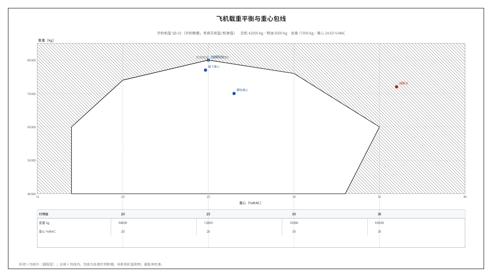

**Template** `LoadBalanceTemplate` · **Document** `LoadBalanceDocument` · **Sample** `demo/OODD.Charts.Demo.Common/TransitSamples.cs`

The horizontal axis is CG in %MAC, the vertical axis weight in kg, and the envelope is an `EnvelopePolygon` in data coordinates: outside is hatched, inside stays blank, and `IsInside` decides exceedance. Every column of the load table shares the same `NumericAxis` as the chart, so table and plot stay aligned without a second conversion.

```csharp
using System;
using System.IO;
using OODD.Charts;
using OODD.Charts.Transit.LoadBalance;
using SkiaSharp;

LoadBalanceDocument doc = new LoadBalanceDocument
{
    AircraftId = "示例机型 SB-01", EmptyWeight = 42000d, EmptyCgPercentMac = 24d,
    FuelKg = 8000d, FuelArm = 26d, CgMin = 15d, CgMax = 40d,
    WeightMin = 40000d, WeightMax = 85000d,
};
doc.Stations.Add(new LoadStation("fwd", "前舱", 1d, 18d, 6000d));
doc.Envelopes.Add(new CgEnvelope("env", "示例包线", new[]
{
    new SKPoint(17f, 40000f), new SKPoint(20f, 74000f), new SKPoint(33f, 40000f),
}));
doc.CheckPoints.Add(new CgCheckPoint("takeoff", "起飞重心",
    doc.CgPercentMacOf(), doc.TotalWeightKg));
using Chart chart = new Chart(doc, new LoadBalanceTemplate());
File.WriteAllBytes("weight-balance.png", chart.Encode(ChartImageFormat.Png, 96f));
```

#### Container stowage plan · `bay-plan`

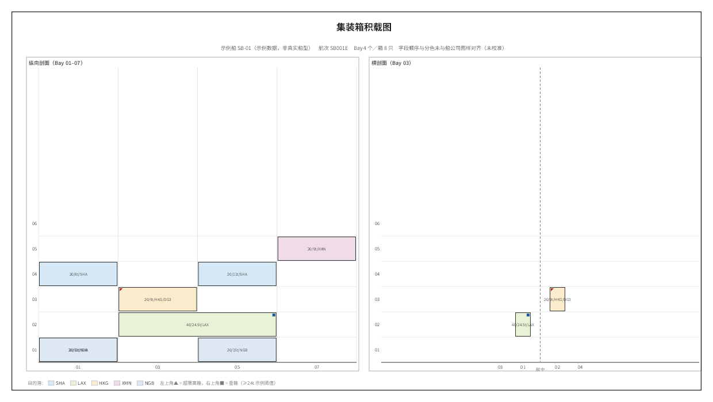

**Template** `StowageTemplate` · **Document** `StowageDocument` · **Sample** `demo/OODD.Charts.Demo.Common/TransitSamples.cs`

The left view draws a bay × tier profile and the right view a row × tier cross-section, with 40-ft boxes left-aligned across two 20-ft bay slots. Tiers grow upward from the bottom and rows expand non-uniformly from the centreline; container text goes through `Painter.Text`, so it remains searchable in SVG.

```csharp
using System;
using System.IO;
using OODD.Charts;
using OODD.Charts.Transit.Stowage;

StowageDocument doc = new StowageDocument
{
    FormTitle = "集装箱积载图",
    VesselId = "示例船 SB-01",
    VoyageId = "SB001E",
    CrossSectionBay = 3,
};
doc.Bays.Add(new StowageBay(1, 2, 2, 6));
doc.Bays.Add(new StowageBay(3, 2, 2, 6));
doc.Bays.Add(new StowageBay(5, 2, 2, 6));
doc.Containers.Add(new StowageContainer(1, 1, 1, ContainerSize.Twenty, 12000d, "SHA"));
doc.Containers.Add(new StowageContainer(3, 1, 2, ContainerSize.Forty, 24500d, "LAX"));
using Chart chart = new Chart(doc, new StowageTemplate());
File.WriteAllBytes("bay-plan.png", chart.Encode(ChartImageFormat.Png, 96f));
```

#### Dangerous goods consignment note · `dg-consignment`

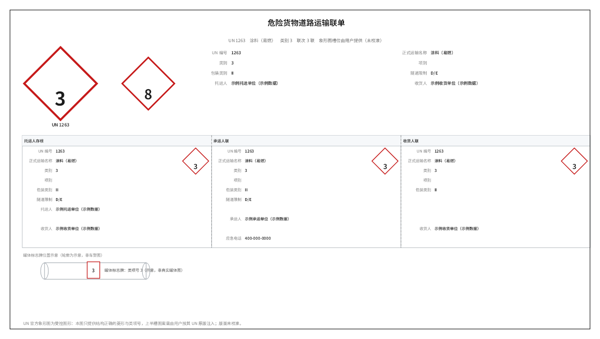

**Template** `DangerousGoodsTemplate` · **Document** `DangerousGoodsDocument` · **Sample** `demo/OODD.Charts.Demo.Common/TransitSamples.cs`

The diamond placard geometry comes from Core's `DiamondPlacard`; the class number sits upright in the lower half, and the UN pictogram can only be injected through `SymbolPath` — the library neither ships nor redraws the official symbol. `AddStandardCopies()` adds three copies (consignor stub, carrier, consignee) side by side: three copies on one page, their widths summing to the collation area width.

```csharp
using System;
using System.IO;
using OODD.Charts;
using OODD.Charts.Transit.DangerousGoods;

DangerousGoodsDocument doc = new DangerousGoodsDocument
{
    FormTitle = "危险货物道路运输联单",
    UnNumber = "1263",
    ProperShippingName = "涂料（易燃）",
    Class = "3",
    PackingGroup = "II",
    Consignor = "示例托运单位",
    Carrier = "示例承运单位",
};
doc.AddStandardCopies();
using Chart chart = new Chart(doc, new DangerousGoodsTemplate());
File.WriteAllBytes("dg-consignment.png", chart.Encode(ChartImageFormat.Png, 96f));
```

#### Oversize transport permit drawing · `ogami-profile`

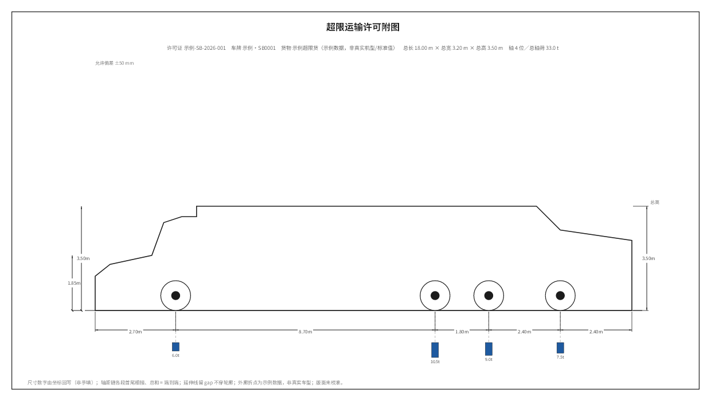

**Template** `OversizeLoadTemplate` · **Document** `OversizeLoadDocument` · **Sample** `demo/OODD.Charts.Demo.Common/TransitSamples.cs`

The vehicle-cargo outline is a closed polyline, and the dimension chain between axles is generated by `DimensionRun`: segments = axles + 1, each measured value written back from pixel coordinates, never typed by the template. The overall-height dimension and key-height coordinates share the same extension-line rules, and axle-load bars are proportional to the tonne values.

```csharp
using System;
using System.IO;
using OODD.Charts;
using OODD.Charts.Transit.OversizeLoad;

OversizeLoadDocument doc = new OversizeLoadDocument
{
    FormTitle = "超限运输许可附图",
    PermitNumber = "示例-SB-2026-001",
    VehiclePlate = "示例·SB0001",
    LengthMeters = 18d,
    HeightMeters = 3.5d,
    WidthMeters = 3.2d,
};
doc.Profile.Add(new OversizeProfilePoint(0d, 0d));
doc.Profile.Add(new OversizeProfilePoint(0d, 3.5d));
doc.Profile.Add(new OversizeProfilePoint(18d, 3.5d));
doc.Profile.Add(new OversizeProfilePoint(18d, 0d));
doc.Profile.Add(new OversizeProfilePoint(0d, 0d));
doc.Axles.Add(new OversizeAxle(2.7d, 6.0d));
using Chart chart = new Chart(doc, new OversizeLoadTemplate());
File.WriteAllBytes("ogami-profile.png", chart.Encode(ChartImageFormat.Png, 96f));
```

### Geoscience

#### Surface weather chart · `surface-chart`

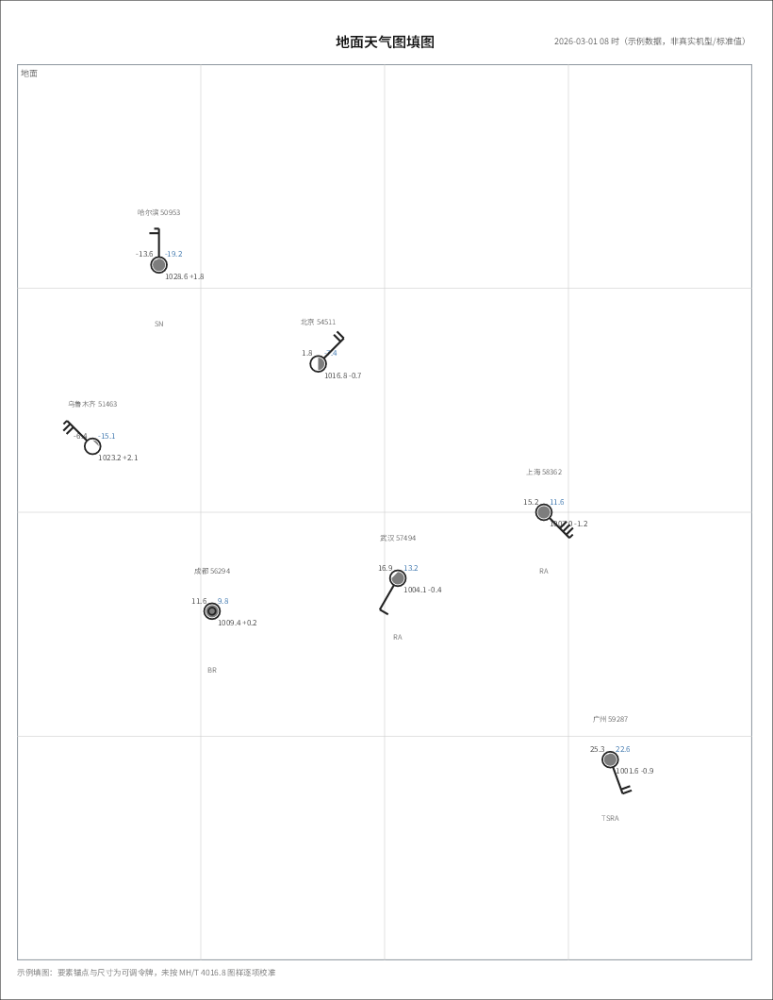

**Template** `SurfaceChartTemplate` · **Document** `SurfacePlotDocument` · **Sample** `demo/OODD.Charts.Demo.Common/GeoscienceSamples.cs`

Each level gets its own panel with the station circle at the centre: temperature upper-left, dew point upper-right, sea-level pressure lower-right, wind barb lower-left. Barbs and feathers are pure geometry rotated about the station circle and contain no text, so the plotted numbers stay searchable text in SVG. With `StackPressureLevels` on, panels divide the height evenly, covering surface and upper-air charts with one template.

```csharp
using System;
using System.IO;
using OODD.Charts;
using OODD.Charts.Geoscience.Surface;

SurfacePlotDocument doc = new SurfacePlotDocument
{
    FormTitle = "地面天气图填图",
    ValidTimeText = "2026-03-01 08 时",
};
SurfaceLevelPlot level = doc.Levels[0];
level.Stations.Add(new SurfaceStation("哈尔滨 50953", 0.16d, 0.20d)
{
    TemperatureC = -13.6d,
    DewPointC = -19.2d,
    PressureHpa = 1028.6d,
    WindDirectionDegrees = 0d,
    WindSpeedMps = 9d,
    CloudOktas = 7,
});
using Chart chart = new Chart(doc, new SurfaceChartTemplate());
File.WriteAllBytes("surface-chart.png", chart.Encode(ChartImageFormat.Png, 96f));
```

#### T-lnP diagram · `tlnp`

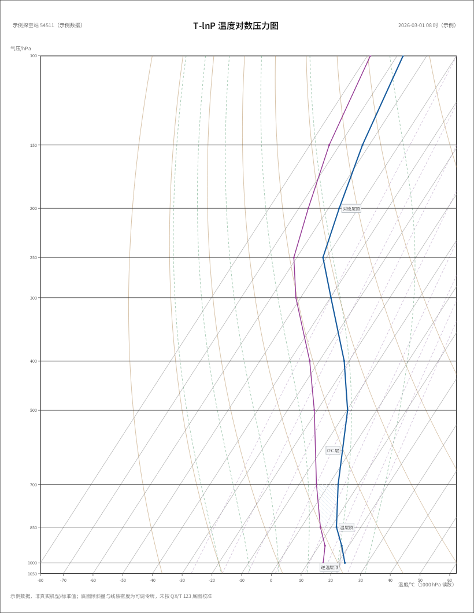

**Template** `TlnpTemplate` · **Document** `SoundingDocument` · **Sample** `demo/OODD.Charts.Demo.Common/GeoscienceSamples.cs`

The vertical axis is logarithmic pressure, so isobars are strictly equidistant; the horizontal coordinate is x = T + skew·log10(P₀/p), which makes isotherms straight in the (x, log p) domain. Isobars, isotherms, dry and moist adiabats, and mixing-ratio lines are all sampled by `LineFamilyGenerator`, while the T and td curves, characteristic-level labels and single-layer hatching all live on one `SoundingDocument`.

```csharp
using System;
using System.IO;
using OODD.Charts;
using OODD.Charts.Geoscience.Tlnp;

SoundingDocument doc = new SoundingDocument
{
    StationName = "示例探空站 54511",
    ValidTimeText = "2026-03-01 08 时",
    HatchedLevelIndex = 1,
};
doc.Levels.Add(new SoundingLevel(1000d, 22.4d, 15.1d));
doc.Levels.Add(new SoundingLevel(850d, 11.8d, 6.4d));
doc.Levels.Add(new SoundingLevel(500d, -9.8d, -21.0d));
doc.CharacteristicLevels.Add(new SoundingCharacteristicLevel(850d, "湿层顶") { PreferLeft = true });
using Chart chart = new Chart(doc, new TlnpTemplate());
File.WriteAllBytes("tlnp.png", chart.Encode(ChartImageFormat.Png, 96f));
```

### Medical (new)

#### Anesthesia record · `anesthesia-record`

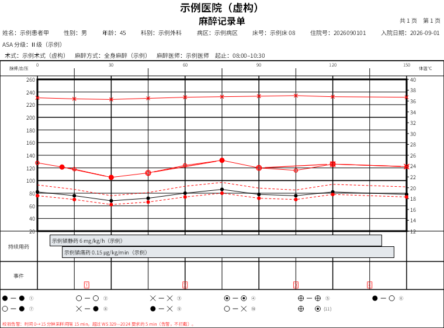

**Template** `AnesthesiaRecordTemplate` · **Document** `AnesthesiaRecordDocument` · **Sample** `demo/OODD.Charts.Demo.Common/NewMedicalSamples.cs`

The left axis (pulse/blood pressure 20–260, step 20) and right axis (temperature 12–40, step 2) share one pixel interval, so horizontal rules are enumerated once from the left axis and label columns sit outside each side. Systolic and diastolic form a pair of curves, continuous infusions are `SpanBand` intervals, and events land as paired endpoint symbols on the time axis.

```csharp
using System;
using System.IO;
using OODD.Charts;
using OODD.Charts.Medical.Forms.AnesthesiaRecord;

AnesthesiaRecordDocument doc = new AnesthesiaRecordDocument
{
    HospitalName = "示例医院",
    FormTitle = "麻醉记录单",
    TotalMinutes = 150,
};
doc.Patient.Name = "示例患者甲";
doc.Patient.AdmissionNumber = "2026090101";
doc.Operation.Procedure = "示例术式";
doc.Operation.AnesthesiaType = "全身麻醉";
doc.Points.Add(new AnesthesiaPoint(0d, 128d, 76d, 93d, 82d, 36.6d, 98d, 34d));
doc.Points.Add(new AnesthesiaPoint(60d, 124d, 74d, 91d, 80d, 36.7d, 98d, 36d));
doc.ContinuousMedications.Add(new ContinuousMedication("示例镇静药", 5d, 140d, "6 mg/kg/h"));
doc.Events.Add(new AnesthesiaEvent(10d, 30d, "BP", 1, 0));
using Chart chart = new Chart(doc, new AnesthesiaRecordTemplate());
File.WriteAllBytes("anesthesia-record.png", chart.Encode(ChartImageFormat.Png, 96f));
```

#### Medical certificate of death (four copies) · `death-certificate`

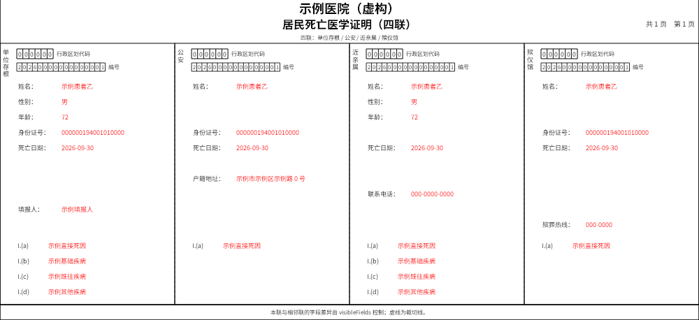

**Template** `DeathCertificateTemplate` · **Document** `DeathCertificateDocument` · **Sample** `demo/OODD.Charts.Demo.Common/NewMedicalSamples.cs`

Four copies are cut horizontally by `CollateSpec`: four copies on one page whose widths sum to the page width. Each copy draws only its visible fields, with a 6-cell `DigitBox` for the administrative code and 17 cells for the serial number. The cause chain I.(a)–(d) keeps a fixed row order and hidden fields keep their blank rows, so the four copies can be compared pixel by pixel on the same y.

```csharp
using System;
using System.IO;
using OODD.Charts;
using OODD.Charts.Medical.Forms.DeathCertificate;

DeathCertificateDocument doc = new DeathCertificateDocument
{
    HospitalName = "示例医院",
    FormTitle = "居民死亡医学证明（四联）",
    AdminCode = "000000",
    SerialNumber = "20260000000000001",
};
doc.Patient.Name = "示例患者乙";
doc.Patient.AdmissionNumber = "000000194001010000";
doc.Set(DeathCertificateFields.DeathDate, "2026-09-30");
doc.Set(DeathCertificateFields.DeathPlace, "示例市示例区示例医院");
doc.Set(DeathCertificateFields.CauseA, "示例直接死因");
doc.Set(DeathCertificateFields.CauseB, "示例基础疾病");
using Chart chart = new Chart(doc, new DeathCertificateTemplate());
File.WriteAllBytes("death-certificate.png", chart.Encode(ChartImageFormat.Png, 96f));
```

#### ICU nursing record · `icu-nursing`

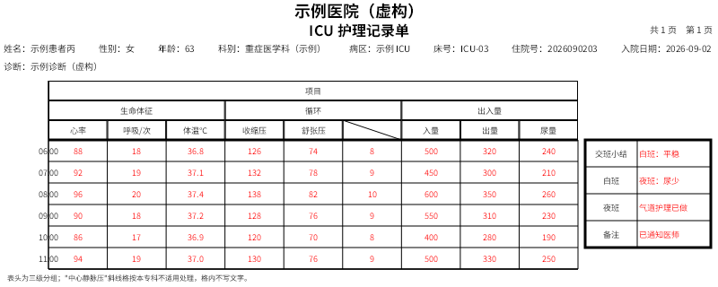

**Template** `IcuNursingTemplate` · **Document** `IcuNursingDocument` · **Sample** `demo/OODD.Charts.Demo.Common/NewMedicalSamples.cs`

The header is a root/group/leaf tree of nine leaf columns placed by `HeaderTableLayout`; the "central venous pressure" leaf is crossed by a diagonal and draws no text. A `SideAttachedTable` on the right carries handover notes with a row height independent of the main table.

```csharp
using System;
using System.IO;
using OODD.Charts;
using OODD.Charts.Medical.Forms.IcuNursing;

IcuNursingDocument doc = new IcuNursingDocument
{
    HospitalName = "示例医院",
    FormTitle = "ICU 护理记录单",
};
doc.Patient.Name = "示例患者丙";
doc.Patient.AdmissionNumber = "2026090203";
IcuRecord record = new IcuRecord("06:00");
record.Set(IcuNursingColumns.All[0], "88");
record.Set(IcuNursingColumns.All[1], "18");
doc.Records.Add(record);
doc.HandoverNotes.Add("白班：平稳");
using Chart chart = new Chart(doc, new IcuNursingTemplate());
File.WriteAllBytes("icu-nursing.png", chart.Encode(ChartImageFormat.Png, 96f));
```

#### Vaccination certificate · `vaccination-booklet`

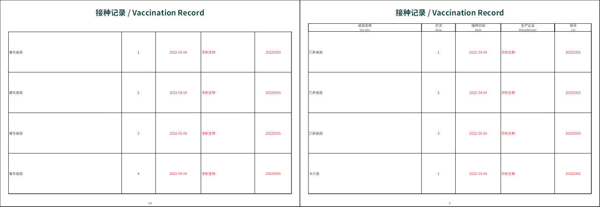

**Template** `VaccinationBookletTemplate` · **Document** `VaccinationBookletDocument` · **Sample** `demo/OODD.Charts.Demo.Common/NewMedicalSamples.cs`

Twelve logical pages are paired for saddle stitching, and `SpreadIndex = 2` selects the (10,3) spread; the record table header is drawn only on the first record page and not repeated across spreads. One export is one spread (two logical pages), which is also one PDF page; `SpreadIndex` turns the page. Spot colours are approximated in RGB while the original CMYK values stay on the document.

```csharp
using System;
using System.IO;
using OODD.Charts;
using OODD.Charts.Medical.Forms.VaccinationBooklet;

VaccinationBookletDocument doc = new VaccinationBookletDocument
{
    HospitalName = "示例社区卫生服务中心",
    FormTitle = "预防接种证",
    TotalLogicalPages = 12,
    SpreadIndex = 2,
};
doc.Patient.Name = "示例儿童";
doc.Patient.AdmissionNumber = "示例建档号 0001";
doc.Records.Add(new VaccinationRecord("乙肝疫苗", "1", "2022-03-04", "示例生物", "20220301"));
doc.Assessments.Add("已完成示例剂次接种，留观无异常。");
using Chart chart = new Chart(doc, new VaccinationBookletTemplate());
File.WriteAllBytes("vaccination-booklet.png", chart.Encode(ChartImageFormat.Png, 96f));
```

#### Antimicrobial susceptibility report · `ast-report`

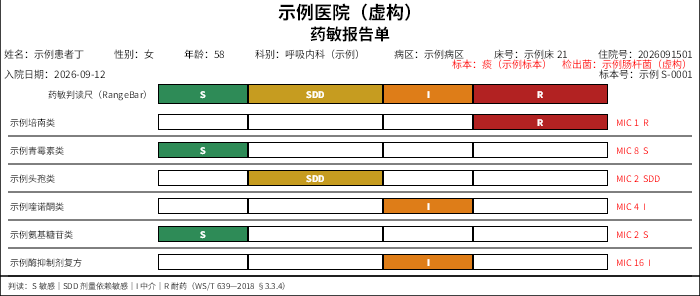

**Template** `AstReportTemplate` · **Document** `AstReportDocument` · **Sample** `demo/OODD.Charts.Demo.Common/NewMedicalSamples.cs`

The interpretation bar `RangeBar` is a plain `WeightedCategoryAxis` with four segments S / SDD / I / R whose widths come from weight tokens (SDD is 1.5× S), so no new axis class is needed. Drug name, MIC and category fill one row each, and the row count follows the number of antibiotics.

```csharp
using System;
using System.IO;
using OODD.Charts;
using OODD.Charts.Medical.Forms.AstReport;

AstReportDocument doc = new AstReportDocument
{
    HospitalName = "示例医院",
    FormTitle = "药敏报告单",
    Specimen = "痰",
    Organism = "示例肠杆菌",
};
doc.Patient.Name = "示例患者丁";
doc.Patient.AdmissionNumber = "2026091501";
doc.Antibiotics.Add(new AstAntibiotic("示例培南类", "1", "R"));
doc.Antibiotics.Add(new AstAntibiotic("示例青霉素类", "8", "S"));
doc.Antibiotics.Add(new AstAntibiotic("示例头孢类", "2", "SDD"));
doc.Antibiotics.Add(new AstAntibiotic("示例喹诺酮类", "4", "I"));
using Chart chart = new Chart(doc, new AstReportTemplate());
File.WriteAllBytes("ast-report.png", chart.Encode(ChartImageFormat.Png, 96f));
```

### Tickets and vouchers

#### Electrical work ticket (first kind) · `electrical-work-ticket`

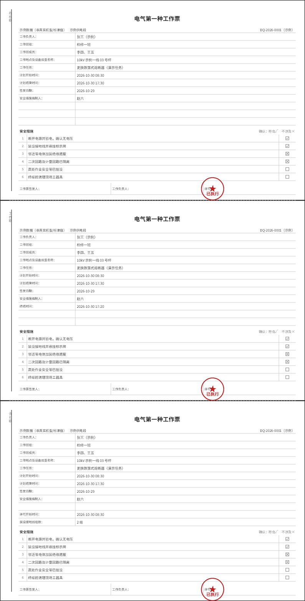

**Template** `ElectricalWorkTicketTemplate` · **Document** `ElectricalWorkTicketDocument` · **Sample** `demo/OODD.Charts.Demo.Common/TicketSamples.cs`

Three copies stack vertically (stub / work / permit): three copies on one page, each spanning the page width, with their heights summing to the page height. The first nine fields are common; the work copy adds termination time, the permit copy adds permit start time and grounding count. Differences are not painted over: each copy writes only its visible fields and leaves the other rows blank on the same grid. Measure rows use the three-state `TriState` geometry (check / cross / empty), and every copy gets its own red "executed" stamp.

```csharp
using System;
using System.IO;
using OODD.Charts;
using OODD.Charts.Render;
using OODD.Charts.Tickets.WorkTicket;

ElectricalWorkTicketDocument doc = new ElectricalWorkTicketDocument
{
    UnitName = "示例供电段",
    SerialNo = "DQ-2026-0001",
    Stamp = WorkTicketStampState.Executed,
};
doc.With(ElectricalWorkTicketFields.WorkLeader, "张三");
doc.With(ElectricalWorkTicketFields.WorkPlace, "10kV 示例一线 03 号杆");
doc.Measures.Add(new TicketMeasureRow("断开电源并验电", TriState.Checked));
doc.Measures.Add(new TicketMeasureRow("装设接地线并悬挂标示牌", TriState.Checked));
doc.Measures.Add(new TicketMeasureRow("邻近带电体加装绝缘遮蔽", TriState.NotApplicable));
using Chart chart = new Chart(doc, new ElectricalWorkTicketTemplate());
File.WriteAllBytes("electrical-work-ticket.png", chart.Encode(ChartImageFormat.Png, 96f));
```

#### Special work ticket · `hot-work-ticket`

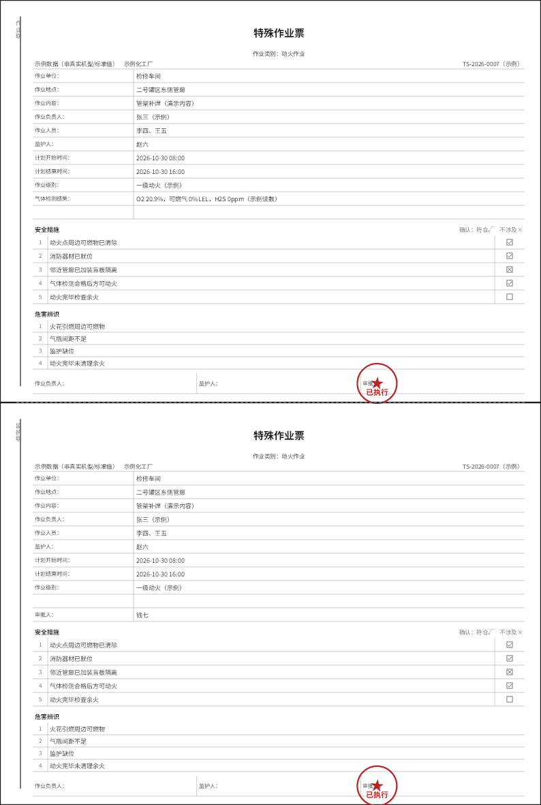

**Template** `HotWorkTicketTemplate` · **Document** `HotWorkTicketDocument` · **Sample** `demo/OODD.Charts.Demo.Common/TicketSamples.cs`

Two copies stack vertically (work / guardian): two copies on one page, each spanning the page width, with their heights summing to the page height. Of the fields, gas test appears only on the work copy and approver only on the guardian copy. Hazard identification is an `AppendableRowGroup`: the number of entries changes the whole page height, so the layout is solved rather than stretched during drawing.

```csharp
using System;
using System.IO;
using OODD.Charts;
using OODD.Charts.Render;
using OODD.Charts.Tickets.WorkTicket;

HotWorkTicketDocument doc = new HotWorkTicketDocument
{
    Category = HotWorkCategory.HotWork,
    UnitName = "示例化工厂",
    SerialNo = "TS-2026-0007",
    Stamp = WorkTicketStampState.Executed,
};
doc.With(HotWorkTicketFields.WorkPlace, "二号罐区东侧管廊");
doc.With(HotWorkTicketFields.GasTest, "O2 20.9%，可燃气 0%LEL");
doc.Measures.Add(new TicketMeasureRow("动火点周边可燃物已清除", TriState.Checked));
doc.Measures.Add(new TicketMeasureRow("消防器材已就位", TriState.Checked));
doc.Hazards.Add("火花引燃周边可燃物");
doc.Hazards.Add("气瓶间距不足");
using Chart chart = new Chart(doc, new HotWorkTicketTemplate());
File.WriteAllBytes("hot-work-ticket.png", chart.Encode(ChartImageFormat.Png, 96f));
```

#### VAT special invoice (four copies) · `vat-invoice`


**Template** `VatInvoiceTemplate` · **Document** `VatInvoiceDocument` · **Sample** `demo/OODD.Charts.Demo.Common/TicketSamples.cs`

Four copies stack vertically (stub / accounting / deduction / invoice): four copies on one page, each spanning the page width, with their heights summing to the page height, and each copy shows only its own extra field (stub number, voucher number, deduction period, reimburser). The invoice number uses an 8-cell `DigitBox`, the cipher area is 4 rows × 21 cells, and a 30-character cipher fills cell by cell while the rest stay blank. The uppercase total is pressed by `PressedAmount` into fixed cells, shrinking to fit without touching the adjacent lowercase amount cell.

```csharp
using System;
using System.IO;
using OODD.Charts;
using OODD.Charts.Tickets.Vat;

VatInvoiceDocument doc = new VatInvoiceDocument
{
    CopyCount = 4,
    InvoiceCode = "000000000000",
    InvoiceNumber = "01234567",
    InvoiceDate = new DateTime(2026, 10, 30),
    CipherText = "0123456789ABCDEFGHIJKLMNOPQRST",
    BuyerName = "示例购买方有限公司",
    SellerName = "示例销售方有限公司",
};
doc.Items.Add(new VatInvoiceItem
{
    Name = "技术服务费", Unit = "次", Quantity = 2d, UnitPrice = 1500.50d, TaxRate = 0.06d,
});
using Chart chart = new Chart(doc, new VatInvoiceTemplate());
File.WriteAllBytes("vat-invoice.png", chart.Encode(ChartImageFormat.Png, 96f));
```

## Radar, engines and host controls

The radar PPI uses a polar layout, and two general-purpose engines cover the "time plus a metric" and "arbitrary table" families of forms. Both share the same `Chart` facade with the medical sheets, so export and host integration need no separate code path.

### Radar PPI (360°) · `radar-full`


**Template** `RadarChartTemplate` · **Document** `RadarDocument` · **Sample** `demo/OODD.Charts.Demo.Common/RadarSample.cs`

The awkward part is that this is not a Cartesian chart: bearing 0° points up and increases clockwise, and distance grows outward from the centre. The template only accepts `RadarDocument`; the scope, compass and info panel are solved once by `RadarLayout`, so after changing `MaxRange`, `RingCount` or the targets call `chart.Invalidate()` — otherwise the next frame still uses the old geometry. The sweep is `SweepAngle` plus `SweepBeamWidth`; here it points at 045° with a 30° trail. Tracks are capped by `TrailLength`, and the panel sits vertically on the right by default.

```csharp
using System;
using System.IO;
using OODD.Charts;
using OODD.Charts.Radar;

RadarDocument doc = new RadarDocument
{
    FormTitle = "雷达态势图（360° 全向）",
    Scope = RadarScope.Full,
    MaxRange = 50d,
    RangeUnit = "km",
    SpeedUnit = "kn",
    RingCount = 5,
    SweepAngle = 45d,
    SweepBeamWidth = 30d,
    SelectedTargetId = "T2",
};
RadarTarget target = new RadarTarget("T2")
{
    Label = "远海 7",
    Bearing = 118d,
    Distance = 32d,
    Speed = 12.6d,
    Course = 128d,
};
target.Track.Add(new RadarTrackPoint(106d, 27.4d));
target.Track.Add(new RadarTrackPoint(112d, 29.7d));
target.Track.Add(new RadarTrackPoint(118d, 32d));
target.Extra["type"] = "货轮";
doc.Targets.Add(target);
doc.InfoPanel.Position = RadarPanelPosition.Right;
doc.InfoPanel.Fields.Add(new RadarInfoField("status"));
doc.InfoPanel.Fields.Add(new RadarInfoField("extra.type", "类型"));
using Chart chart = new Chart(doc, new RadarChartTemplate());
File.WriteAllBytes("radar-full.png", chart.Encode(ChartImageFormat.Png, 96f));
```

### Radar PPI (180° sector) · `radar-half`

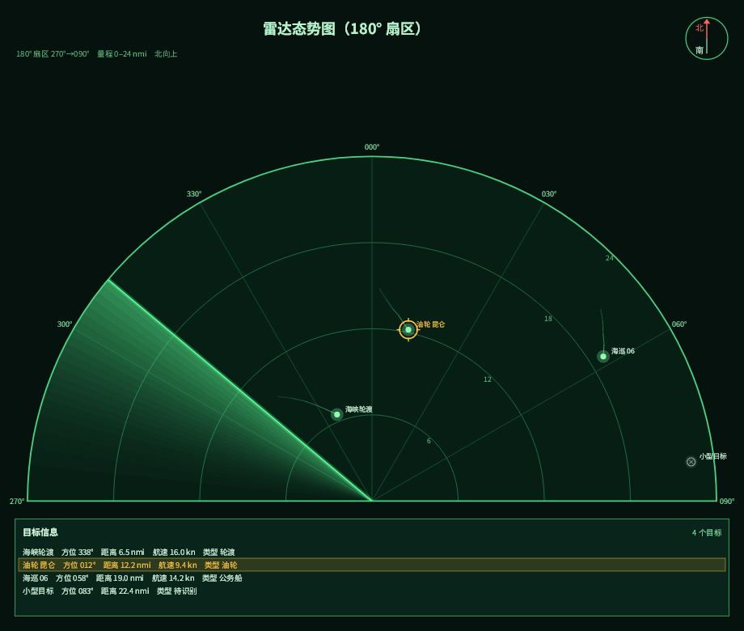

**Template** `RadarChartTemplate` · **Document** `RadarDocument` · **Sample** `demo/OODD.Charts.Demo.Common/RadarSample.cs`

The 180° version is not a cropped 360° render: set `Scope = RadarScope.Half` and choose `HalfStartBearing`. The default 270 means the sector runs clockwise from 270° to 90°, covering the upper half. The angular extent is expressed by those two properties only — the span is fixed at 180°, there is no separate sector-span property; what you can tune is the start bearing, the range and the ring count. The sweep line is still `SweepAngle` and may sit outside the sector, because it is a beam direction rather than a clip. The info panel moves to the bottom, one line per target.

```csharp
using System.IO;
using OODD.Charts;
using OODD.Charts.Radar;

RadarDocument doc = new RadarDocument
{
    FormTitle = "雷达态势图（180° 扇区）",
    Scope = RadarScope.Half,
    HalfStartBearing = 270d,
    MaxRange = 24d,
    RangeUnit = "nmi",
    RingCount = 4,
    SweepAngle = 310d,
    SweepBeamWidth = 34d,
    TrailLength = 8,
};
doc.Targets.Add(new RadarTarget("B2")
{
    Label = "油轮 昆仑",
    Bearing = 12d,
    Distance = 12.2d,
    Speed = 9.4d,
    Course = 20d,
});
doc.InfoPanel.Position = RadarPanelPosition.Bottom;
using Chart chart = new Chart(doc, new RadarChartTemplate());
File.WriteAllBytes("radar-half.png", chart.Encode(ChartImageFormat.Png, 96f));
```

### Radar interaction and sweep animation

All interaction lives in `RadarInteraction`; host controls only forward pointer events and run a timer. `TryCreate` returns null for a non-radar chart, so you can assign it to `Interaction` without a type check. `ChartInteractionHost` maps view coordinates to 96 dpi logical coordinates and keeps a `Stopwatch`; the timer only calls its `Tick()` each frame, which passes the real elapsed time to `RadarInteraction.Tick(elapsed)`. To drive an external target list, subscribe to `SelectionChanged` or call `Select(id)` directly.

```csharp
using System;
using OODD.Charts;
using OODD.Charts.Adapters.WinForms;
using OODD.Charts.Radar;
using OODD.Charts.Rendering;

RadarDocument doc = new RadarDocument { MaxRange = 50d };
doc.Targets.Add(new RadarTarget("T1") { Label = "渔政 3102", Bearing = 32d, Distance = 18.5d });
using Chart chart = new Chart(doc, new RadarChartTemplate());

ChartControl view = new ChartControl
{
    Chart = chart,
    Fit = ChartFit.Fit,
    Dock = System.Windows.Forms.DockStyle.Fill,
};
view.Interaction = RadarInteraction.TryCreate(chart);
```

| Action | Behaviour |
|---|---|
| Click a target | Within the hit radius (`HitTolerance`, 12 logical px by default) it writes `SelectedTargetId`; the scope draws a selection ring and the matching panel block is highlighted |
| Hover | Writes `HoverTargetId`, draws a thin ring and switches to a hand cursor; leaving the control clears it |
| Click empty scope | Clears the selection; the letterbox area of `Fit` mode is not part of the scope, so it will not clear by accident |
| Outside the layout | Hit testing is skipped: a press does not change the selection, and moving out clears hover |
| Sweep animation | `Tick(elapsed)` advances by the real milliseconds supplied by the caller, 60°/s by default; `IsAnimating = false` stops only the sweep, selection and hover keep working |

### Two general-purpose form engines

Both engines are concrete classes, so you do not need a subclass to try them: `new TimelineFormTemplate()` and `new FormSheetTemplate()` work directly. Each casts its document to `TimelineFormDocument` / `FormSheetDocument` and throws on anything else, so do not feed a temperature document into them.

#### Time plus one primary metric (`TimelineFormTemplate`)

**Template** `TimelineFormTemplate` · **Document** `TimelineFormDocument` · **Sample** `demo/OODD.Charts.Demo.Common/CodeBlueSample.cs`

The horizontal axis is the list of `TimeLabels`; each `ChartGroup` is one group (a day or a stage). The vertical axis is cut by `MinorStep`, while `MajorStep` only controls the heavy rules. The primary metric is a `PointSeries`; accessory rows are declared with `TimelineRow` and filled per slot through `CellValue`. The example below is a fictional "intraoperative vital signs record" and defines no new class.

```csharp
using System;
using System.IO;
using OODD.Charts;
using OODD.Charts.Medical.Forms;
using OODD.Charts.Model;
using SkiaSharp;

TimelineFormDocument doc = new TimelineFormDocument
{
    HospitalName = "示例医院",
    FormTitle = "术中生命体征记录",
    AxisLabel = "心率（次/分）",
    AxisMin = 40d, AxisMax = 160d, MinorStep = 20d, MajorStep = 40d,
};
doc.Patient.Name = "示例患者";
foreach (string time in new[] { "08:00", "08:15", "08:30", "08:45", "09:00" }) doc.TimeLabels.Add(time);
doc.Days.Add(new ChartGroup(new DateTime(2026, 3, 18)));
doc.Rows.Add(new TimelineRow("event", "术中事件"));
PointSeries hr = new PointSeries("hr", TimelineFormDocument.DefaultAxisKey)
{
    Symbol = MarkerSymbol.Dot, Color = SKColors.Red, LegendText = "心率",
};
hr.Values[0] = 82d; hr.Values[2] = 96d; hr.Values[4] = 78d;
doc.Series.Add(hr);
doc.Events.Add(new EventMark(2, "追加局麻"));
doc.Cells.Add(new CellValue("event", 2, "追加局麻 5mL"));
using Chart chart = new Chart(doc, new TimelineFormTemplate());
File.WriteAllBytes("timeline-form.png", chart.Encode(ChartImageFormat.Png, 96f));
```

#### Pure tables (`FormSheetTemplate`)

**Template** `FormSheetTemplate` · **Document** `FormSheetDocument` · **Sample** `demo/OODD.Charts.Demo.Common/CancerPsychologyConsultSample.cs`

The sheet has no axes, only sections: a `FormSection` carries column definitions, `FormRow`s and an optional full-width `Note`. Column widths are weights, not pixels; with `Wrap` on, long text wraps to the column and the row grows. `AddRow` pads cells to the column count, and `SetCell` writes by section and row `Key` without touching layout.

```csharp
using System.IO;
using OODD.Charts;
using OODD.Charts.Medical.Forms;

FormSheetDocument doc = new FormSheetDocument
{
    HospitalName = "示例医院",
    FormTitle = "设备交接班记录",
    FooterNote = "交接双方签字：____________",
};
doc.Patient.Name = "示例患者";
FormSection section = new FormSection("交接项目",
    new FormColumn("项目", 1.2f, CellAlign.Near),
    new FormColumn("班次", 1f),
    new FormColumn("备注", 3f, CellAlign.Near));
section.Key = "handover";
doc.AddSection(section);
doc.AddRow("handover", "monitor", "监护仪", "白班", "运行正常");
doc.AddRow("handover", "pump", "输液泵", "夜班", "电池待换");
doc.SetCell("handover", "pump", 2, "电池已换");
using Chart chart = new Chart(doc, new FormSheetTemplate());
File.WriteAllBytes("form-sheet.png", chart.Encode(ChartImageFormat.Png, 96f));
```

### Seven host controls

Each platform exposes one entry control with the same shape: `Chart`, `Fit`, `ScaleFactor`, `Dpi` and `Interaction`. WinForms, WPF and Avalonia are verified on this machine down to byte-identical PNGs against `Chart.Encode(Png)`; Eto, WinUI, Uno and MAUI are currently verified only at compile level — the API contract and the pixel bridge are shared, but there is no runtime evidence here. All snippets below continue from the same `chart`.

```csharp
using OODD.Charts;
using OODD.Charts.Radar;

RadarDocument doc = new RadarDocument { MaxRange = 50d };
doc.Targets.Add(new RadarTarget("T1") { Label = "渔政 3102", Bearing = 32d, Distance = 18.5d });
using Chart chart = new Chart(doc, new RadarChartTemplate());
```

| Platform | Entry point | Verification on this machine |
|---|---|---|
| WinForms | `ChartControl` / `chart.ToBitmap` | Pixel-level, 0 difference against the baseline PNG |
| WPF | `ChartControl` / `chart.ToWriteableBitmap` | Pixel-level, 0 difference |
| Avalonia | `ChartControl` / `chart.ToWriteableBitmap` | Pixel-level, 0 difference (headless + Skia) |
| Eto.Forms | `ChartControl` / `chart.ToEtoBitmap` | Compile-level verification only |
| WinUI 3 | `ChartControl` / `chart.ToWriteableBitmap` | Compile-level verification only |
| Uno Platform | `ChartControl` / `chart.ToWriteableBitmap` | Compile-level verification only |
| MAUI | `ChartImage` / `ChartCanvasView` / `chart.ToImageSource` | Compile-level verification only |

WinForms additionally ran pointer messages against a real control handle (hover, click-select, click-empty-to-clear, animation timer start/stop). The other platforms share the same `ChartInteractionHost` but currently have compile evidence only.

#### WinForms

The control double-buffers and renders at the control DPI; `ToBitmap` copies the same BGRA frame into a GDI+ bitmap and matches the baseline PNG pixel for pixel on this machine.

```csharp
using System.Drawing;
using System.Windows.Forms;
using OODD.Charts.Adapters.WinForms;
using OODD.Charts.Radar;
using OODD.Charts.Rendering;

ChartControl view = new ChartControl
{
    Chart = chart,
    Fit = ChartFit.Fit,
    Dock = DockStyle.Fill,
};
view.Interaction = RadarInteraction.TryCreate(chart);
using Bitmap bitmap = chart.ToBitmap(96f);
bitmap.Save("winforms.png", System.Drawing.Imaging.ImageFormat.Png);
```

#### WPF

`ToWriteableBitmap` writes the BGRA frame straight into a `WriteableBitmap` and freezes it, so it can cross threads after creation; creation itself must happen on the UI thread.

```csharp
using System.Windows.Media.Imaging;
using OODD.Charts.Adapters.Wpf;
using OODD.Charts.Radar;
using OODD.Charts.Rendering;

ChartControl view = new ChartControl { Chart = chart, Fit = ChartFit.Fit, Dpi = 0d };
view.Interaction = RadarInteraction.TryCreate(chart);
WriteableBitmap bitmap = chart.ToWriteableBitmap(96d);
```

#### Avalonia

Same contract as WPF: `ToWriteableBitmap` returns an Avalonia `WriteableBitmap`, and the control handles pointer input itself. Verified headless with Skia on this machine.

```csharp
using Avalonia.Media.Imaging;
using OODD.Charts.Adapters.Avalonia;
using OODD.Charts.Radar;
using OODD.Charts.Rendering;

ChartControl view = new ChartControl { Chart = chart, Fit = ChartFit.Fit };
view.Interaction = RadarInteraction.TryCreate(chart);
WriteableBitmap bitmap = chart.ToWriteableBitmap(96d);
```

#### Eto.Forms

`ToEtoBitmap` copies row by row into the native buffer behind `Bitmap.Lock()`, handling `ScanWidth` padding and flipped rows. Eto requires an initialized platform, so create the bitmap after `Application` starts.

```csharp
using Eto.Drawing;
using OODD.Charts.Adapters.Eto;
using OODD.Charts.Radar;
using OODD.Charts.Rendering;

ChartControl view = new ChartControl { Chart = chart, Fit = ChartFit.Fit };
view.Interaction = RadarInteraction.TryCreate(chart);
Bitmap bitmap = chart.ToEtoBitmap(96d);
```

#### WinUI 3

`WriteableBitmap` is an STA-bound COM object; rasterize on a worker thread if you like, then hop back to the UI thread to create the bitmap.

```csharp
using Microsoft.UI.Xaml.Controls;
using Microsoft.UI.Xaml.Media.Imaging;
using OODD.Charts.Adapters.WinUi;
using OODD.Charts.Radar;
using OODD.Charts.Rendering;

ChartControl view = new ChartControl { Chart = chart, Fit = ChartFit.Fit };
view.Interaction = RadarInteraction.TryCreate(chart);
WriteableBitmap bitmap = chart.ToWriteableBitmap(192d);
Image host = new Image { Source = bitmap, Width = 960d };
```

#### Uno Platform

The same `WriteableBitmap` contract as WinUI 3; Uno 5.x also uses the `Microsoft.UI.Xaml` namespaces.

```csharp
using Microsoft.UI.Xaml.Controls;
using Microsoft.UI.Xaml.Media.Imaging;
using OODD.Charts.Adapters.Uno;
using OODD.Charts.Radar;
using OODD.Charts.Rendering;

ChartControl view = new ChartControl { Chart = chart, Fit = ChartFit.Fit };
view.Interaction = RadarInteraction.TryCreate(chart);
WriteableBitmap bitmap = chart.ToWriteableBitmap(192d);
Image host = new Image { Source = bitmap };
```

#### MAUI

`ChartImage` is an `Image` subclass that re-renders when `Chart`, `Dpi` or `Fit` changes; `ToImageSource` goes through PNG bytes, the only public MAUI path that accepts raw pixels. For interaction use `ChartCanvasView`, which draws vectors directly and exposes `Interaction`.

```csharp
using Microsoft.Maui.Controls;
using OODD.Charts.Adapters.Maui;
using OODD.Charts.Radar;
using OODD.Charts.Rendering;

ChartImage still = new ChartImage { Chart = chart, Dpi = 192f, Fit = ChartFit.Fit };
Image image = new Image { Source = chart.ToImageSource(96f) };

ChartCanvasView live = new ChartCanvasView { Chart = chart, Fit = ChartFit.Fit };
live.Interaction = RadarInteraction.TryCreate(chart);
```

### Export and fonts

Export entry points live on `Chart`: PNG/JPEG are raster, PDF/SVG stay vector. DPI only affects `canvas.Scale`; geometry is solved once at 96 dpi, so 300 dpi rules sit exactly on top of the 96 dpi ones and you do not need a print-specific layout. `PdfOptions` ships with `Auto`, `A4Portrait`, `A4Landscape` and `A5Portrait`, or you can set page width, height, margins and scaling yourself.

```csharp
using System.IO;
using OODD.Charts;
using OODD.Charts.Fonts;
using OODD.Charts.Radar;
using OODD.Charts.Style;

RadarDocument doc = new RadarDocument { MaxRange = 50d };
doc.Targets.Add(new RadarTarget("T1") { Bearing = 32d, Distance = 18.5d });
ChartStyle style = new ChartStyle();
style.Text.Family = "Noto Sans SC";
style.Text.HospitalBold = false;
style.Text.TitleBold = false;
FontCollection embedded = new FontCollection();
embedded.Add(File.OpenRead("NotoSansSC-Regular.otf"));
using Chart chart = new Chart(doc, new RadarChartTemplate(), style);
chart.Fonts = new SystemFontResolver(embedded);
File.WriteAllBytes("radar.png", chart.Encode(ChartImageFormat.Png, 96f));
File.WriteAllBytes("radar.jpg", chart.Encode(ChartImageFormat.Jpeg, 300f, 92));
PdfOptions options = new PdfOptions
{
    PageWidthPt = 595.28f,
    PageHeightPt = 841.89f,
    MarginPt = 12f,
    ShrinkToFit = true,
    ExpandToFitWidth = false,
    Title = "雷达态势图",
    Author = "示例医院",
};
using (FileStream pdf = File.Create("radar.pdf")) chart.WritePdf(pdf, options);
using (FileStream svg = File.Create("radar.svg")) chart.WriteSvg(svg);
```

Fonts are resolved by `SystemFontResolver`, the default `IFontResolver`: requested family → built-in CJK candidates (YaHei, SimSun, PingFang, Noto, Source Han…) → probe character `'体'` matched against system fonts → `SKTypeface.Default`, so it never returns null. For PDF, Skia subsets a typeface when it can and embeds the whole file when it cannot; Microsoft YaHei (a .ttc) produced a 23.2 MB PDF for one sheet on this machine, while the same sheet in Noto Sans SC came out at about 160 KB. There is no extra "subset switch" in the library — change `Text.Family` or embed the font. `Chart.SharedFonts` is process-wide and must not be disposed.

Screenshots in this repository are rendered with Noto Sans SC (OFL). The library ships no font files; names such as YaHei or SimSun in the candidate list are only family requests to the OS at runtime.

## What is verified

The checks in this repo are not "the image opens". Every command below is reproducible locally:

```bash
dotnet build OODD.Charts.slnx
dotnet test tests/OODD.Charts.Tests/OODD.Charts.Tests.csproj -f net8.0
dotnet test tests/OODD.Charts.Tests/OODD.Charts.Tests.csproj -f net462
dotnet run --project tools/OODD.Charts.Samples -f net8.0-windows
dotnet run --project tools/OODD.Charts.Samples -f net8.0-windows -- artifacts --forensics
dotnet run --project tools/OODD.Charts.AdapterCheck -f net8.0-windows
```

| Check | Current measured result |
|---|---|
| Build | 0 warnings / 0 errors across net462, netstandard2.0 and net8.0 |
| Tests | **473/473** on net8.0 and 473/473 on net462 |
| Samples | `ALL SAMPLES OK`: all 40 forms assert cell height, rule weight, shared baselines, slot width, then write PNG/PDF/SVG |
| Forensics | `ALL FORENSICS OK`: 17 extended forms × 96/120/144/192 dpi |
| Adapters | WinForms / WPF / Avalonia produce **byte-identical** output to the core raster; 7 control-level mouse-message checks pass |
| Cross-TFM | The same document produces identical PNG bytes on net462 and net8.0 |

Every standalone C# block in this README was extracted and compiled: quick start, 38 form snippets, radar and engine examples — 45 in total. The seven host-control snippets depend on their platform TFMs and are not part of that compile.

## Known limitations

- **No net40.** SkiaSharp has never shipped a net40 target; net462 is the floor. `netstandard2.0` covers .NET Core, .NET 5+, Mono and Xamarin.
- **Eto / WinUI 3 / Uno / MAUI are compile-verified only.** This machine has no runtime or graphical session for them, so no pixel comparison is claimed. WinForms / WPF / Avalonia were measured at zero-byte difference.
- **PDF embeds the full font by default** — about 23 MB for a Chinese document; a subset brings it to roughly 160 KB. Commercial fonts (SimSun, Microsoft YaHei) must not be redistributed; use Source Han Sans / Noto (OFL) before embedding.
- **No CMYK separation or print tolerance.** SkiaSharp is an RGB pipeline; spot colours keep their original CMYK values plus an RGB approximation. Prepress still needs dedicated software.
- **The 17 extended forms are not pixel-calibrated against national standards.** 3 have source evidence, 12 are structurally verified but uncalibrated, 2 are structure-only. Tune the exposed tokens against your own sample before using them as official documents.
- **Interaction exists only for the radar** (click, hover, sweep). Other forms expose geometry and inverse mapping primitives but no per-form `HitTest`; in-cell editing belongs to the application.
- `TemperatureChart/` holds a GDI+ reference implementation found online. It is used only for early layout measurements, is not compiled, and is not published with this repository.

## License

Apache-2.0, see [LICENSE](LICENSE).

Depends on SkiaSharp (MIT) and its native libraries (BSD-3-Clause — the license of Skia's native binaries, not a font license). Check font licensing before redistribution.
